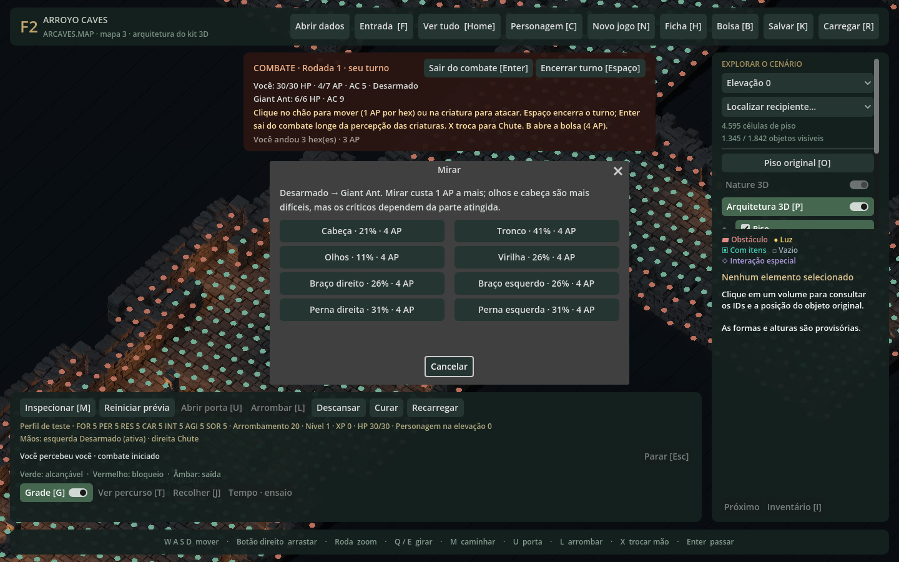
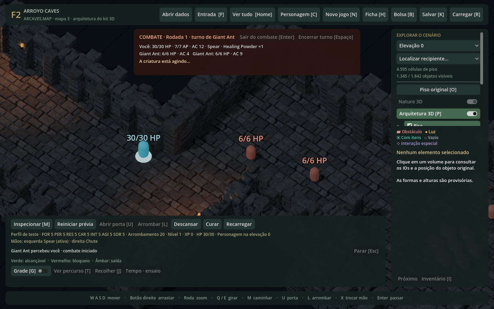
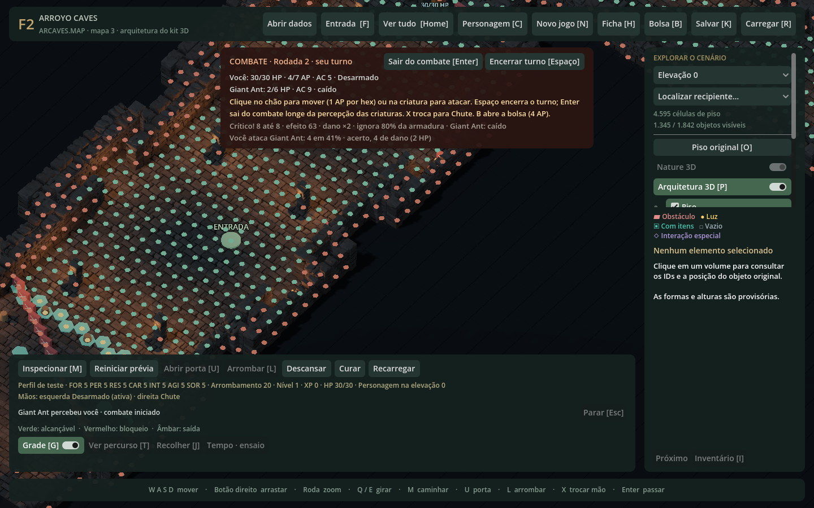
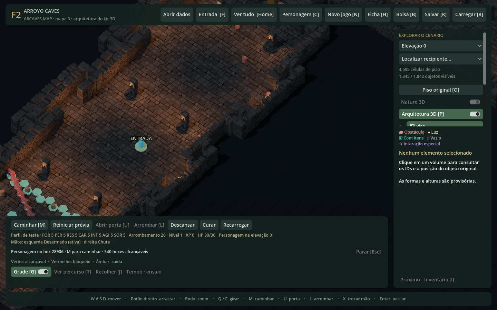
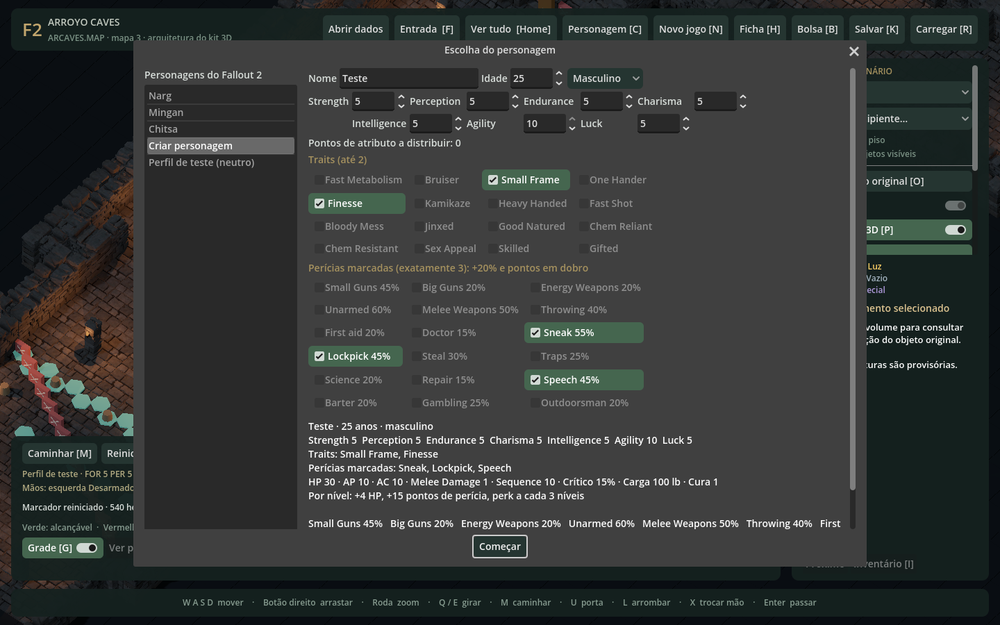
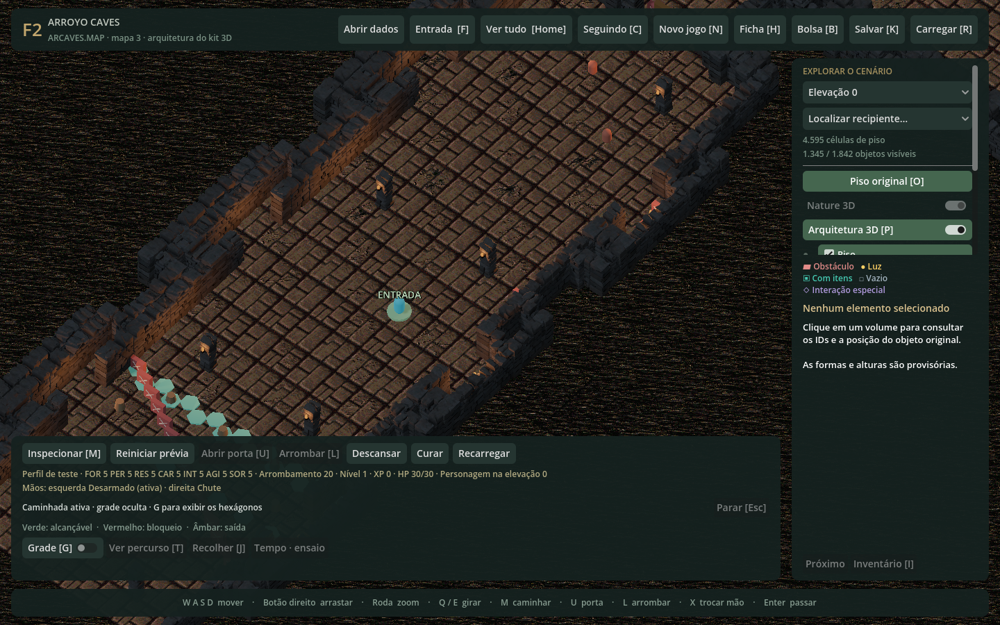
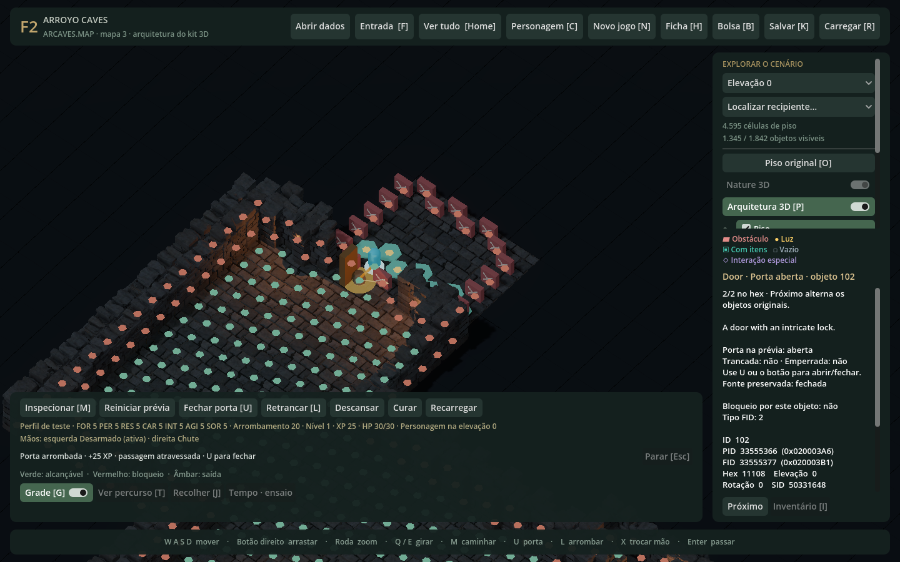
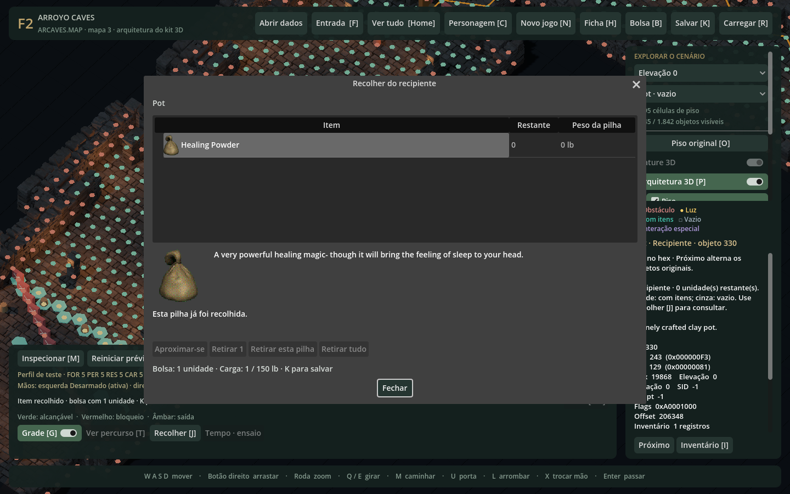
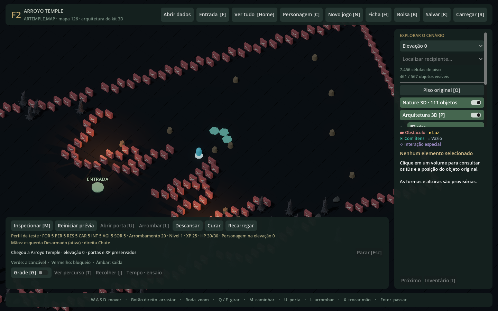
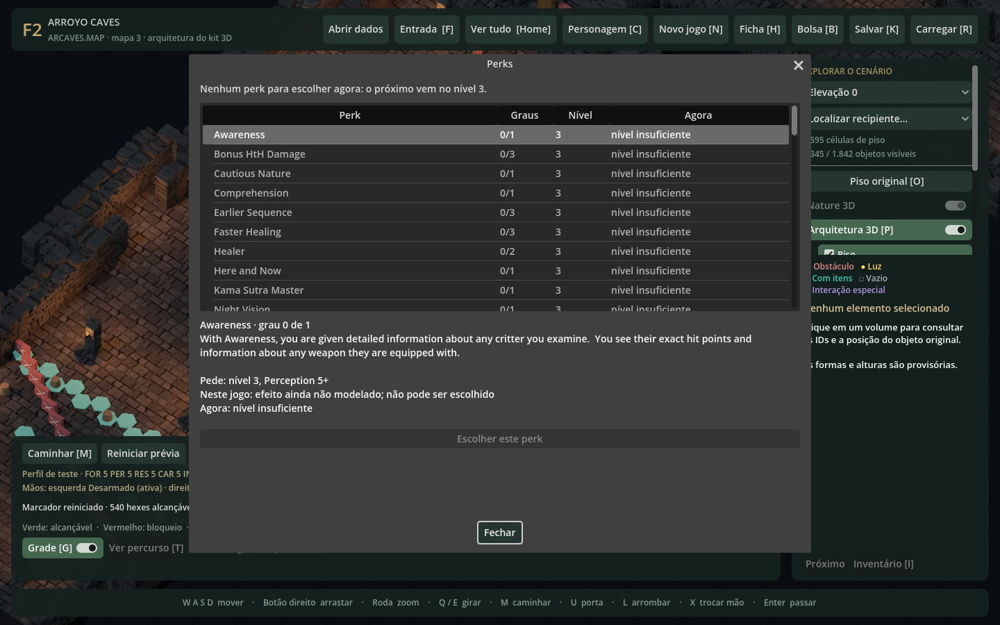

# FalloutRemake — Recriação de Fallout 2 em Godot 4 .NET / C#

[](https://dotnet.microsoft.com/)
[](https://godotengine.org/)
[]()
[]()
[]()
[-yellow.svg)](https://github.com/alexbatalov/fallout2-ce)

Projeto de recriação de **Fallout 2** desenvolvido em **Godot 4 .NET / C#**, adotando uma apresentação isométrica 3D com iluminação e qualidade de materiais inspiradas em *Wasteland 3*, preservando com fidelidade matemática e binária as regras, opcodes e estruturas do motor original via **Fallout 2 Community Engine (CE)**.

---

## ⚡ Vibe Coding com Engenharia Séria: O Workflow Multi-Agente em Paralelo

Embora este projeto tenha sido desenvolvido sob a filosofia de **"Vibe Coding"** (código guiado por intenção e desenvolvido massivamente por Inteligência Artificial), ele não utiliza o paradigma frágil de "prompt-and-pray". Foi desenhado e implementado um **workflow profissional de engenharia com múltiplos harnesses de IA operando simultaneamente em paralelo**:

```text
                               ┌──────────────────────────────────────────────────────────┐
                               │           MEMÓRIA COMPARTILHADA ENTRE AGENTES            │
                               │  • Servidor MCP ai-memory (decisões históricas e fatos)  │
                               │  • Documentação Canônica (AGENTS.md, PROJECT_STATUS.md)  │
                               └────────────────────────────┬─────────────────────────────┘
                                                            │
                 ┌──────────────────────────────────────────┼──────────────────────────────────────────┐
                 │                                          │                                          │
                 ▼                                          ▼                                          ▼
   ┌───────────────────────────┐              ┌───────────────────────────┐              ┌───────────────────────────┐
   │       HARNESS CODEX       │              │       HARNESS CLAUDE      │              │    HARNESS ANTIGRAVITY    │
   │      (OpenAI Codex)       │              │     (Anthropic Claude)    │              │      (Google Gemini)      │
   ├───────────────────────────┤              ├───────────────────────────┤              ├───────────────────────────┤
   │ Worktree:                 │              │ Worktree:                 │              │ Worktree:                 │
   │ D:\Dev\FalloutRemakeCodex │              │ D:\Dev\FalloutRemakeClaude│              │ D:\Dev\FalloutRemakeArgon │
   │ Branch: agent/codex-work  │              │ Branch: agent/claude-work │              │ Branch: agent/argon-work  │
   │ Foco: Domínio, diálogos,  │              │ Foco: Núcleo de combate,  │              │ Foco: Pipeline de assets, │
   │ regras de RPG e sessão    │              │ chamadas de mira e IA CE  │              │ conversões e automação    │
   └─────────────┬─────────────┘              └─────────────┬─────────────┘              └─────────────┬─────────────┘
                 │                                          │                                          │
                 └──────────────────────────────────────────┼──────────────────────────────────────────┘
                                                            │
                                                            ▼
                                              ┌───────────────────────────┐
                                              │    BRANCH INTEGRATION     │
                                              │ (D:\Dev\FalloutRemake...  │
                                              │       Integracao)         │
                                              ├───────────────────────────┤
                                              │ Quality Gate:             │
                                              │ 481 Testes Sintéticos     │
                                              │ Console em ~1,4s          │
                                              └─────────────┬─────────────┘
                                                            │
                                                            ▼
                                              ┌───────────────────────────┐
                                              │     BRANCH MAIN (PROD)    │
                                              │    (D:\Dev\FalloutRemake) │
                                              └───────────────────────────┘
```

### Pilares desse Workflow Profissional:

1. **Isolamento Físico via Git Worktrees:**
   - Cada harness de IA trabalha em uma pasta de trabalho física separada (`D:\Dev\FalloutRemakeCodex`, `FalloutRemakeClaude`, `FalloutRemakeArgon`), conectadas ao mesmo repositório Git local.
   - Isso elimina qualquer colisão de arquivos de trava (*lockfiles*), impede que um agente sobrescreva a árvore de trabalho de outro e permite que múltiplos modelos trabalhem e compilem em paralelo simultaneamente.

2. **Memória Compartilhada e Sem Alucinações (MCP + Docs Canônicos):**
   - Agentes de diferentes fornecedores (OpenAI, Anthropic, Google) compartilham as mesmas decisões arquiteturais através de um **servidor MCP de memória vetorial (`ai-memory`)** e arquivos canônicos obrigatórios ([`AGENTS.md`](AGENTS.md) e [`docs/PROJECT_STATUS.md`](docs/PROJECT_STATUS.md)).
   - Antes de iniciar qualquer tarefa, o agente consulta o histórico de decisões e contratos técnicos homologados, eliminando regresso de código e perda de contexto entre sessões.

3. **Quality Gates Ultra-Rápidos (.NET 8 puro C#):**
   - Como os subsistemas de regras de negócio (`Import`, `Geometry`, `Runtime`) são C# puro completamente desacoplados da engine gráfica, o console de testes [`tools/TempleInspector`](tools/TempleInspector/TempleInspector.csproj) valida **481 grupos de testes sintéticos em ~1,4 segundo**.
   - É **obrigatório** pelo protocolo do projeto que qualquer agente execute a suíte antes e depois de qualquer modificação. Se um único teste quebrar, a alteração é sumariamente rejeitada.

4. **Ambiente Não-Intrusivo no Desktop:**
   - O projeto possui o runner [`tools/Run-QuietGodot.ps1`](tools/Run-QuietGodot.ps1), que inicia o Godot em um desktop virtual do Windows para testes visuais e capturas de tela sem roubar o foco, mover o mouse ou atrapalhar o desenvolvedor enquanto ele utiliza a máquina.

5. **Intercambialidade com Rigor Crítico:**
   - Nenhum modelo tem monopólio sobre uma tarefa. As tarefas são distribuídas por afinidade, disponibilidade ou cotas. Nenhum agente pode assumir que o código de outro modelo está correto sem conferir evidências reais no código e nos testes.

### 🎨 Pipeline Híbrido de Criação de Assets 3D (Multi-Tier Cost & Quality):

Para reconstruir o mundo isométrico em 3D preservando com perfeição a identidade visual de 1998 e otimizando os custos de inferência de IA, foi implementada uma esteira de produção multimodelos:

```text
  [ Sprites 2D Originais ] (.FRM do Fallout 2 clássico)
             │
             ▼
  [ Estágio 1: IA de Geração de Imagens (Google / Imagen) ]
  • Analisa os sprites clássicos e gera no chat concepts ultra-detalhados
  • Define vistas ortogonais, proporções anatômicas/arquitetônicas e medidas métricas
             │
             ▼
  [ Estágio 2: Prototipagem Rápida de Baixo Custo (Gemini Flash no Antigravity) ]
  • IA rápida e econômica para criar protótipos de malha 3D e scripts de automação
  • Mapeamento de caixas delimitadoras (bounding boxes) e testes preliminares
             │
             ▼
  [ Estágio 3: Refinamento Estético e Homologação Final (Anthropic Claude) ]
  • Auditoria rigorosa de proporções artísticas, topologia e materiais PBR
  • Refinamento da geometria até o modelo 3D final (.GLB) pronto para o Godot
```

1. **Estágio 1 — Concept e Folha de Proporções (IA Geradora de Imagens / Google):** A partir dos sprites e renders clássicos em 2D do Fallout 2, a IA gera ilustrações conceituais de alta fidelidade com folhas de proporções, ângulos ortogonais e especificações de medidas no chat.
2. **Estágio 2 — Prototipagem Acelerada (Gemini Flash via Antigravity):** Utilizando um modelo ágil e de baixo custo operacional (**Gemini Flash**) dentro do harness Antigravity, são gerados os protótipos preliminares, estruturas de colisão, nós de cena e automações da pipeline.
3. **Estágio 3 — Refinamento e Arte Final (Anthropic Claude):** O modelo **Claude** realiza a engenharia fina e o refinamento estético: validação de proporções em relação ao motor clássico, ajuste de shaders/PBR e homologação do modelo 3D final em `.glb` integrado à cena.

---


## 1. Visão Geral da Arquitetura

O projeto adota uma separação rigorosa entre a **lógica de domínio (C# puro .NET 8 desacoplado)** e a **camada de apresentação (Godot 4)**:

```text
src/
├── Import/    (29 arquivos) -> C# Puro (.NET 8). Decodificação de arquivos DAT, MAP, PRO, INT, GAM, MSG, FRM, GCD e AI.
├── Geometry/  (11 arquivos) -> C# Puro (.NET 8). Grid hexagonal de 40.000 hexes, BFS, pathfinding CE, linha de tiro e oclusão.
├── Runtime/   (65 arquivos) -> C# Puro (.NET 8). Máquina de estados (WorldSession), combate por turnos, fichas, perks, medicina e checkpoints v1-v13.
└── Preview/   (114 arquivos)-> Camada Godot 4. TemplePreview, adaptadores de visão, HUD de combate, janelas modais e testes in-engine.
```

Toda a lógica central de regras, combate, inventário e checkpoints é executada e testada pelo console [`tools/TempleInspector`](tools/TempleInspector/TempleInspector.csproj) **em ~1,4 segundo**, sem nenhuma dependência gráfica ou inicialização do Godot.

---

## 📸 Galeria de Gameplay e Capturas (NVIDIA RTX)

Todas as capturas abaixo foram geradas em alta resolução (1440x900) diretamente na cena Godot renderizada via Direct3D 12 na GPU NVIDIA GeForce RTX:

| Combate por Turnos e Disparos Mirados | Encontro com Criaturas (Giant Ants) |
| :---: | :---: |
|  |  |
| *Janela de disparos mirados (Called Shots) nos 8 membros com custos de AP e probabilidades* | *Início de combate por linha de visão e iniciativa com criaturas no Templo* |

| Acerto Crítico e Dano Autêntico | Arquitetura 3D do Templo dos Ensaios |
| :---: | :---: |
|  |  |
| *Acerto crítico autêntico do CE com efeito Knockdown e log detalhado* | *Kit modular de pedras e iluminação por tochas no interior do Templo* |

| Criação de Personagem SPECIAL | Grid Hexagonal e Pathfinding |
| :---: | :---: |
|  |  |
| *Editor de atributos SPECIAL com 40 pontos, traits e tag skills* | *Grid de 40.000 hexágonos, pathfinder BFS do CE e visualização de alcance* |

| Arrombamento de Portas (Lockpick) | Gestão de Inventário e Capacidade de Carga |
| :---: | :---: |
|  |  |
| *Segunda porta com adaptador de lockpick determinístico e 25 XP* | *Janela de contêiner com cálculo atômico de peso por Força e Take All* |

| Ambiente Externo e Assets PBR | Progressão e Árvore de Perks |
| :---: | :---: |
|  |  |
| *Área externa do Templo com rochas e árvores queimadas PBR (Assets/Nature)* | *Consulta da tabela de perks clássicos com requisitos de nível e efeitos reais* |

---

---

## 2. Subsistemas Implementados

### ⚔️ Combate Tático por Turnos (Fiel ao Fallout 2 CE)
- **Núcleo de Combate em C# Puro:** Implementado em [`src/Runtime/Combat/`](src/Runtime/Combat/) (`CombatSession.cs`, `DamageCalculator.cs`, `CriticalRules.cs`, `CombatAi.cs`, `CombatInitiative.cs`).
- **Pontos de Ação e Iniciativa:** Ordem de turnos calculada deterministicamente por Sequência e Percepção, consumo de AP para movimentação, ataques, recarga e abertura de inventário (4 AP).
- **Cálculo de Dano Autêntico:** Aplicação exata de *Damage Threshold* (DT) e *Damage Resistance* (DR) baseados nas tabelas de munição e armadura do Fallout 2.
- **Disparos Mirados (*Called Shots*):** Janela dedicada de mira ([`CalledShotWindow.cs`](src/Preview/CalledShotWindow.cs)) com alvos em Cabeça, Olhos, Tronco, Braço Direito, Braço Esquerdo, Perna Direita, Perna Esquerda e Virilha, com penalidades de precisão e custos adicionais de AP.
- **Tabelas de Críticos Originais:** Mais de 66 KB de dados em [`CriticalRules.cs`](src/Runtime/Combat/CriticalRules.cs), reproduzindo fielmente as tabelas de acerto e falha crítica do `fallout2.exe`.
- **Armas de Fogo e Balística:** Rastreamento de cartuchos e carregadores, recarga no mundo e em combate, dispersão de rajada (*burst spray*) por cálculo angular e perks de armas (Long Range, Scope Range, Accurate, Penetrate, Fast Reload).
- **Combate Melee, Desarmado e Arremesso:** Alternância entre soco e chute com bônus de dano desarmado; mecânica de arremesso de lanças consumindo o item da mão e posicionando-o no chão do hex de impacto.
- **Dois Slots de Mão e Armadura:** Suporte aos dois slots ativos de mão do Fallout 2 e slot de armadura ativa com aplicação de Classe de Armadura (AC), bônus de Força e resistência a radiação.
- **IA Tática dos Inimigos:** Inimigos orientados pelo algoritmo `combat_ai` do Community Engine com leitura de pacotes `ai.txt` originais.
- **Encontros no Templo dos Ensaios:** Combates integrados com Formigas Gigantes (*Giant Ants*) e Escorpiões-Rad (*Radscorpions*), com veneno acumulando no relógio de jogo ([`PoisonRules.cs`](src/Runtime/Combat/PoisonRules.cs)).
- **Desafio Final de Cameron:** Três vias de resolução comprovadas: persuasão diplomática (Speech), duelo desarmado até a rendição ou combate com coleta da chave do Templo do corpo.

### 📜 Diálogos, Missões e Transição para Arroyo
- **Diálogo da Anciã (*Elder*):** Implementação completa em [`src/Runtime/ArroyoElderConsultation.cs`](src/Runtime/ArroyoElderConsultation.cs) cobrindo o primeiro diálogo (`Node001`), a conversa repetida (`Node004`), e os ramos de aceitação e lembrete da busca pelo GECK (`Node015`, `Node007`, `Node016`).
- **Concessão de Recompensas:** Entrega controlada de 152 tampas (`PID 41`) e do cantil de Vic (`PID 267`), com gravação de variáveis globais (`GVAR_TALKED_TO_ELDER`, `GVAR_DEN_VIC_KNOWN`) e locais no checkpoint.
- **Transição de Mapa e Experiência:** Saída do Templo pela porta 100 com transição para `maps/arvillag.map`, concessão de 600 XP (ou 300 XP caso Cameron tenha sido morto) com persistência de Karma e Reputação.

### 👤 Criação de Personagem, Ficha, Progressão e Sobrevivência
- **Criação de Personagem:** Distribuição de 40 pontos SPECIAL, escolha de até 2 características (*Traits*) e 3 perícias marcadas (*Tag Skills*).
- **Personagens Pré-definidos:** Leitura direta dos arquivos `.gcd` originais (`Narg`, `Mingan` e `Chitsa`).
- **Progressão de Nível:** Subida de nível por acúmulo de XP com tabela original e distribuição de pontos de perícia com custo progressivo do editor clássico.
- **Perks e Traits:** Efeitos reais integrados de *Lifegiver*, *Educated*, *Tag!*, *Mutate!*, *Here and Now*, *Swift Learner*, *One Hander* e *Jinxed*.
- **Medicina e Cura:** Perícias *First Aid* e *Doctor* exercitáveis com kits de primeiros socorros e limite de 3 usos diários; uso de Pó de Cura (*Healing Powder*) e descanso natural pelo Pip-Boy (*Pipboy Rest* com checagem de mapa seguro).

### 📦 Inventário, Carga e Manipulação de Objetos
- **Cálculo Rigoroso de Peso:** Limite de carga atômico baseado em Força ($25 + \text{Força} \times 25\text{ lb}$), com validação estrita prévia antes de qualquer coleta.
- **Coleta e Devolução Rápida:** Funções *"Retirar tudo"* (*Take All*) e *"Devolver tudo"* (*Return All*) com conservação atômica de quantidades e preservação dos contêineres de origem.
- **Barreira Explosiva do Templo:** Posicionamento de dinamite plástica, temporizador configurável (10 a 180 segundos), detonação atômica no relógio de jogo e abertura física da passagem para a elevação 2.
- **Arrombamento e Portas:** Adaptador de arrombamento (*Lockpick*) determinístico para a segunda porta com concessão única de 25 XP; portas com abertura e bloqueio físico no grid.

### 💾 Persistência e Checkpoints (v1 a v13)
- **Serialização Multi-Mapa Atômica:** Gravação e restauração em JSON mantendo estado de portas, contêineres, itens posicionados/consumidos, inventário da bolsa, dados de combate, cargas de armas, perks e progresso de diálogos (`SavedElderState`).
- **Compatibilidade Reversa:** Migração determinística automática de saves legados (`v1` a `v12`) para o schema consolidado `v13`.

### 🗺️ Importação Direta e Geometria Hexagonal
- **Leitura Nativa de Binários:** Carregamento de arquivos clássicos sem descompactação manual (`master.dat`, `critter.dat`, `*.map`, `*.pro`, `*.int`, `*.frm`, `*.msg`, `*.gam`).
- **Grid Hexagonal Fiel:** Grid matemático de 40.000 hexágonos com conversão 3D/Hex, pathfinding BFS do CE e respeito a `NO_BLOCK`, `MULTIHEX` e elevações 0–2.
- **Apresentação 3D:** Kit modular de pedras para o Templo dos Ensaios, modelos de natureza PBR (rochas e árvores queimadas) e sistema de corte de oclusão de paredes (*Wall Occlusion*).

---

## 3. Como Executar

### Pré-requisitos
- [.NET 8 SDK](https://dotnet.microsoft.com/download/dotnet/8.0)
- [Godot Engine 4 .NET (C#)](https://godotengine.org/download) (versão 4.3 ou 4.7 Mono)
- Instalação clássica de **Fallout 2** (para fornecimento de `master.dat` e `critter.dat`). *Nenhum asset proprietário é distribuído no repositório.*

### Compilação e Testes Sintéticos (.NET CLI)

Na raiz do repositório:

```powershell
# 1. Compilar o projeto Godot e ferramentas
dotnet build 'Fallout Remake.csproj'

# 2. Executar a suíte completa de 481 testes sintéticos (~1,4 segundo)
dotnet run --project tools/TempleInspector -- --self-test
```

### Relatórios e Conformidade de Dados Originais

Para conferir a decodificação dos arquivos originais e a verificação byte a byte:

```powershell
$dataDir = "C:\Caminho\Para\Fallout2"

# Inspecionar mapa e integridade estrutural
dotnet run --project tools/TempleInspector -- --data-dir $dataDir

# Relatório de regras de armas de fogo
dotnet run --project tools/TempleInspector -- --data-dir $dataDir --firearms-report

# Relatório de diálogo da Anciã
dotnet run --project tools/TempleInspector -- --data-dir $dataDir --elder-report
```

### Executar a Apresentação no Godot

1. Abra o arquivo `project.godot` no **Godot Engine (.NET)**.
2. Pressione **F5** (ou clique em Reproduzir).
3. Na primeira execução, se solicitado, aponte para a pasta de dados do seu Fallout 2 contendo `master.dat` e `critter.dat`. O caminho fica salvo localmente em `.local/`.

### 🎥 Gravar Gameplay com a Ferramenta NVIDIA (NVIDIA App / ShadowPlay)

O projeto suporta captura direta em 60 FPS com aceleração de hardware NVENC na GPU NVIDIA:

1. Inicie a cena interativa do jogo:
   ```powershell
   & "D:\Downloads\Godot_v4.7.2-stable_mono_win64\Godot_v4.7.2-stable_mono_win64\Godot_v4.7.2-stable_mono_win64_console.exe" --path .
   ```
2. Utilize os atalhos oficiais da NVIDIA:
   - **`Alt + F9`**: Iniciar ou encerrar a gravação de vídeo.
   - **`Alt + Z`**: Abrir a sobreposição da NVIDIA App para ajustar resolução, taxa de quadros e atalhos.
3. Os vídeos são salvos automaticamente no diretório padrão da NVIDIA (`%USERPROFILE%\Videos\NVIDIA\Desktop\`).


---

## 4. Controles Principais na Cena (`TemplePreview`)

| Tecla / Ação | Ação |
| :--- | :--- |
| **WASD** / Botão Direito | Movimentar a câmera isométrica livre |
| **Q / E** | Girar a visão de câmera |
| **Roda do Mouse** | Zoom in / Zoom out |
| **C** | Centralizar câmera e acompanhar o personagem |
| **M** | Alternar modo Caminhar (clique no chão para traçar rota por hexágonos) |
| **U** | Interagir com porta (Abrir / Fechar) |
| **L** | Arrombar porta trancada (Lockpick) |
| **J** | Abrir contêiner / Coletar itens (*Take All* / Seleção de quantidade) |
| **B** | Abrir bolsa do jogador (*Player Bag* / Gerenciamento de itens e peso) |
| **I** | Inspecionar inventário original do objeto selecionado |
| **K** | **Salvar Checkpoint** no slot local |
| **R** | **Restaurar Checkpoint** do slot local |
| **V** | Alternar corte automático de oclusão de paredes |
| **G** | Mostrar / Ocultar grade de hexágonos |
| **O** | Alternar sobreposição do piso original 2D |
| **Enter** | Confirmar travessia de transição de elevação / área |
| **Esc** | Parar caminhada no passo atual / Cancelar seleção |

---

## 5. Diretrizes para Desenvolvimento e IA

O projeto adota regras estritas de integridade técnica para desenvolvedores e agentes autônomos documentadas em [`AGENTS.md`](AGENTS.md):

1. **Validação Obrigatória:** A suíte de 481 testes (`tools/TempleInspector --self-test`) deve ser executada e aprovada antes e depois de qualquer alteração em C#.
2. **Ambiente Não Intrusivo:** Execuções do Godot para testes automatizados devem usar `--headless` ou o runner isolado [`tools/Run-QuietGodot.ps1`](tools/Run-QuietGodot.ps1).
3. **Preservação dos Dados Originais:** Proibida qualquer alteração em IDs originais (PIDs, FIDs, SIDs), tabelas MSG ou binários clássicos.

---

## 6. Licença e Reconhecimentos

- **Código:** Distribuído sob a licença [MIT](LICENSE).
- **Fallout 2:** Marca registrada da Bethesda Softworks LLC / ZeniMax Media. Este é um projeto de estudo e engenharia reversa sem fins lucrativos.
- **Fallout 2 Community Engine (CE):** Agradecimento especial ao projeto de engenharia reversa [fallout2-ce](https://github.com/alexbatalov/fallout2-ce) de Alex Batalov pelas referências de algoritmos e estruturas.
