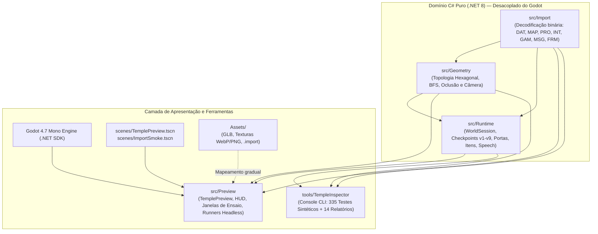
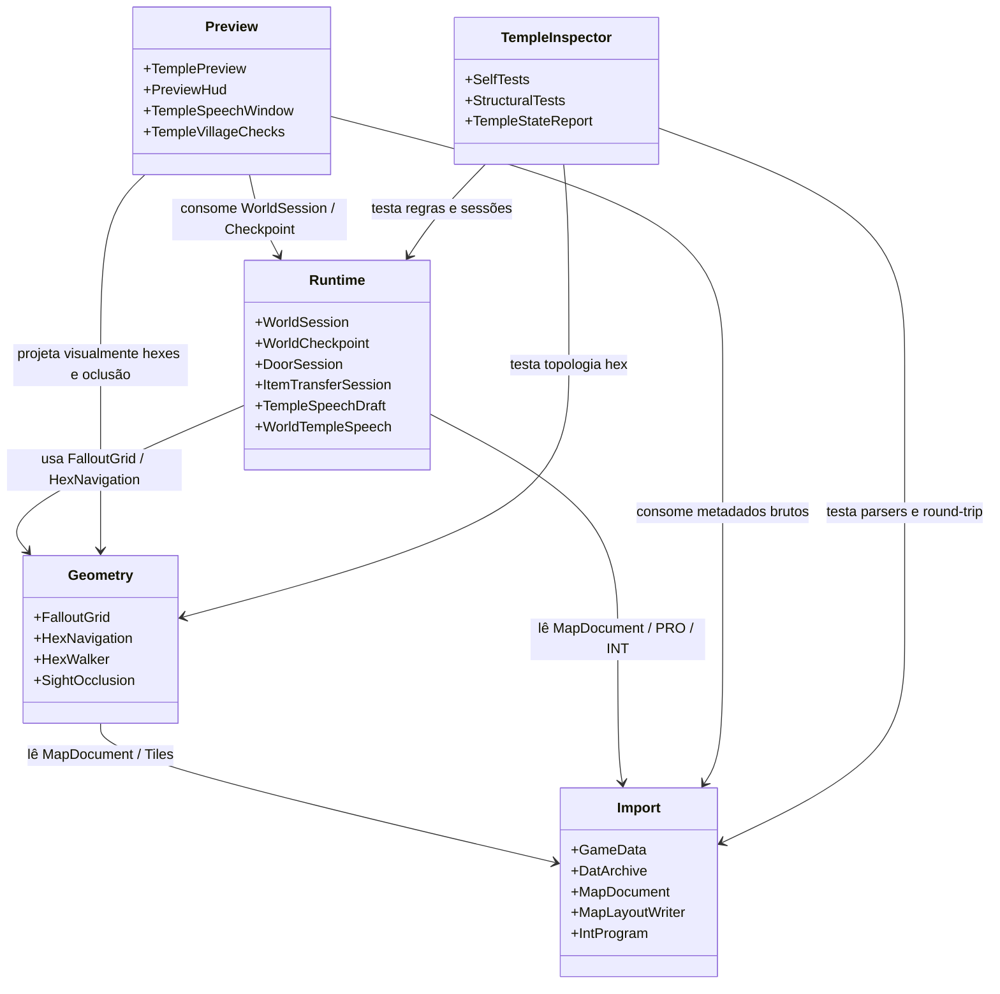
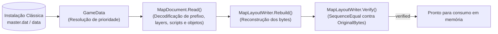
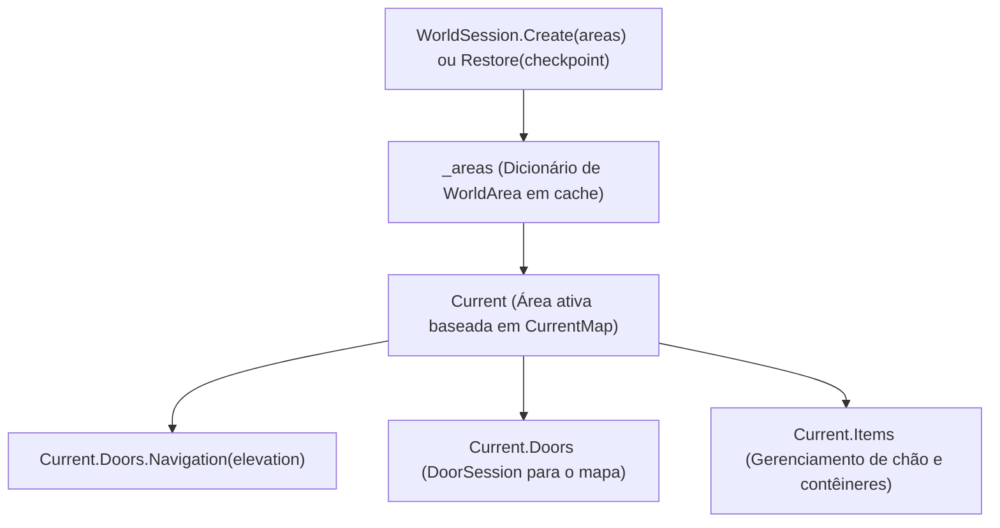
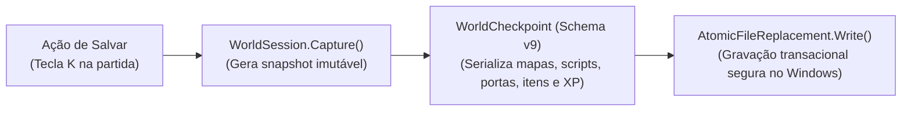
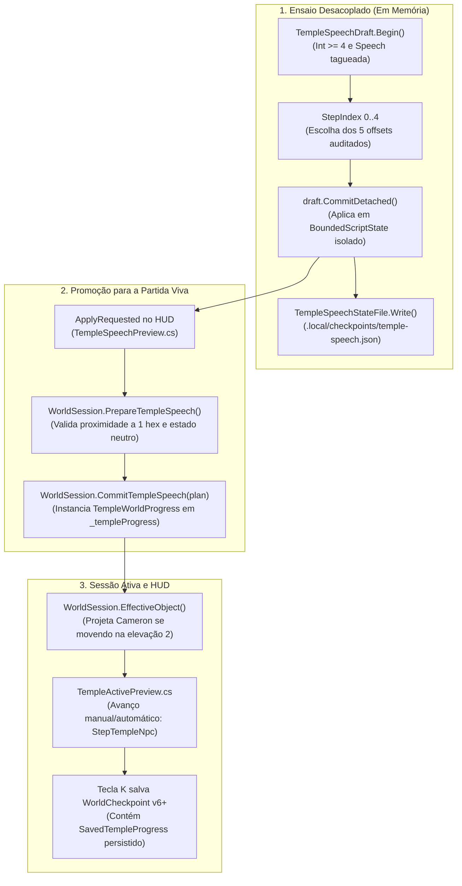
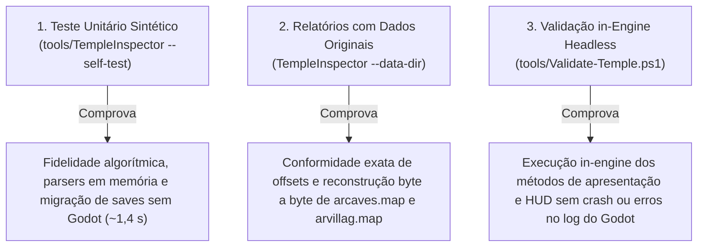

# Mapa Arquitetural — FalloutRemake

> **Data de Elaboração:** 22/10/2026  
> **Branch Ativa:** `codex/arroyo-elder-entry-audit`  
> **Commit Base:** `a66f31c`  
> **Documentos Operacionais de Referência:**
> - Regras de Segurança e Isolamento: [AGENTS.md](../AGENTS.md)
> - Estado dos Sistemas e Marcos: [docs/PROJECT_STATUS.md](PROJECT_STATUS.md)
> - Comandos de Build e Testes: [docs/WORKFLOW.md](WORKFLOW.md)

---

## 1. Visão Geral e Modelo Mental

O **FalloutRemake** adota uma arquitetura em camadas estritamente desacoplada entre a lógica de domínio C# e o motor gráfico Godot 4.

### Princípio Fundamental de Desacoplamento
Os três subsistemas centrais de regras (`src/Import`, `src/Geometry` e `src/Runtime`) são escritos em **C# puro (.NET 8)**, sem qualquer dependência do Godot (`using Godot;`). Isso permite que toda a inteligência do jogo, cálculos de grid, parsers e regras de sessão sejam compilados e testados de forma ultrarrápida (~1,4 s) via projeto de console de diagnóstico (`tools/TempleInspector`), sem necessidade de inicializar a engine.

---

## 2. Estrutura de Camadas e Responsabilidades

### 2.1 `src/Import` (23 arquivos C# — .NET 8 Puro)
Responsável pela decodificação estrita e sem mutação de todos os formatos binários originais do Fallout 2:
- **Pacotes e Resolução de Recursos:** [DatArchive.cs](../src/Import/DatArchive.cs) (leitura de arquivos `.dat` com descompressão zlib, caminhos normalizados e bounds checks) e [GameData.cs](../src/Import/GameData.cs) (gerencia a ordem clássica de prioridade: `f2_res.dat` $\to$ patches numerados `patch000.dat` $\to$ pasta `data/` $\to$ `critter.dat` $\to$ `master.dat`).
- **Estruturas de Mapa (MAP v20):** [MapDocument.cs](../src/Import/MapDocument.cs) (modelo do mapa em memória), [MapPrefix.cs](../src/Import/MapPrefix.cs) (cabeçalho de 236 bytes, elevações 0, 1 e 2, tiles de piso/teto e variáveis de script) e [MapLayoutWriter.cs](../src/Import/MapLayoutWriter.cs) (reconstrução dos bytes a partir dos campos interpretados e verificação de integridade).
- **Protótipos de Objetos (PRO):** [CritterPrototypeData.cs](../src/Import/CritterPrototypeData.cs) e [PrototypeCatalog.cs](../src/Import/PrototypeCatalog.cs) (atributos SPECIAL, perícias, danos e resistências em formatos de 412 ou 416 bytes).
- **Scripts Compilados (SSL / INT):** [IntProgram.cs](../src/Import/IntProgram.cs), [IntDialogueOptions.cs](../src/Import/IntDialogueOptions.cs), [IntExternalReferences.cs](../src/Import/IntExternalReferences.cs), [IntVariableReads.cs](../src/Import/IntVariableReads.cs) e [IntVariableWrites.cs](../src/Import/IntVariableWrites.cs) (desmontagem, rotas de diálogo, opcodes e análise estática do bytecode sem emulação de máquina virtual).
- **Textos e Variáveis Globais:** [MessageText.cs](../src/Import/MessageText.cs) (tabelas de mensagens `.msg`) e [GameGlobalFile.cs](../src/Import/GameGlobalFile.cs) (leitura de `vault13.gam`).
- **Gráficos e Arte 2D (FRM):** [FloorArt.cs](../src/Import/FloorArt.cs), [InventoryArt.cs](../src/Import/InventoryArt.cs) e [InventoryView.cs](../src/Import/InventoryView.cs) (paletas, transparência, dimensões e frames de inventário/chão).

### 2.2 `src/Geometry` (8 arquivos C# — .NET 8 Puro)
Responsável pelo espaço bidimensional e isométrico, topologia hexagonal e enquadramento visual:
- **Grid Hexagonal Clássico:** [FalloutGrid.cs](../src/Geometry/FalloutGrid.cs) (fórmulas idênticas ao Community Engine para conversão entre 3D/espaço contínuo e grid de $200 \times 200 = 40.000$ hexágonos, paridade de linhas e distâncias euclidianas no tabuleiro).
- **Pathfinding e Navegação:** [HexNavigation.cs](../src/Geometry/HexNavigation.cs) (algoritmo BFS respeitando elevações, bloqueadores e flags `NO_BLOCK`, `MULTIHEX`) e [HexWalker.cs](../src/Geometry/HexWalker.cs) (interpolação e simulação de passos hex a hex a 5 passos/s).
- **Oclusão e Visão:** [SightOcclusion.cs](../src/Geometry/SightOcclusion.cs) (cálculo de corte de paredes e visibilidade isométrica da câmera).
- **Enquadramento de Câmera:** [Framing.cs](../src/Geometry/Framing.cs) (cálculo puramente matemático do frustum e da área segura da câmera ortográfica sem inicializar o Godot).
- **Apresentação de Entidades:** [FloorArtwork.cs](../src/Geometry/FloorArtwork.cs), [NaturePresentation.cs](../src/Geometry/NaturePresentation.cs) e [EntityPresentation.cs](../src/Geometry/EntityPresentation.cs).

### 2.3 `src/Runtime` (35 arquivos C# — .NET 8 Puro)
Núcleo da máquina de estados do jogo, persistência e regras de negócio:
- **Sessão do Mundo:** [WorldSession.cs](../src/Runtime/WorldSession.cs) (orquestra o mapa ativo, ator, áreas carregadas em cache `_areas`, transições e inventário).
- **Checkpoints Atômicos:** [WorldCheckpoint.cs](../src/Runtime/WorldCheckpoint.cs) (definição e migração determinística de saves `v1` a `v9`) e [AtomicFileReplacement.cs](../src/Runtime/AtomicFileReplacement.cs) (gravação transacional no Windows com renomeação segura, impedindo corrupção de savegame).
- **Portas e Bloqueadores:** [DoorSession.cs](../src/Runtime/DoorSession.cs), [TempleDoorAdapter.cs](../src/Runtime/TempleDoorAdapter.cs) (gerencia portas, arrombamento e concessão única de 25 XP) e [TempleExitDoorProfile.cs](../src/Runtime/TempleExitDoorProfile.cs) (porta 100 de saída).
- **Inventário e Carga:** [ItemTransferSession.cs](../src/Runtime/ItemTransferSession.cs) (operações de "Take All" e "Return All"), [CarryWeight.cs](../src/Runtime/CarryWeight.cs) (limite atômico de peso por Força) e [ItemOriginRoute.cs](../src/Runtime/ItemOriginRoute.cs) (rastreamento do contêiner de origem para devolução de itens sem duplicação).
- **Explosivo e Barreira:** [ExplosiveTimer.cs](../src/Runtime/ExplosiveTimer.cs), [ExplosiveUseProposal.cs](../src/Runtime/ExplosiveUseProposal.cs), [TempleBarrierProjection.cs](../src/Runtime/TempleBarrierProjection.cs) e [TempleBarrierEffectProposal.cs](../src/Runtime/TempleBarrierEffectProposal.cs) (temporização, detonação lógica e remoção atômica do bloqueador de barreira).
- **Speech e Fuga do NPC (Cameron):** [TempleSpeechDraft.cs](../src/Runtime/TempleSpeechDraft.cs), [TempleSpeechStateFile.cs](../src/Runtime/TempleSpeechStateFile.cs), [WorldTempleSpeech.cs](../src/Runtime/WorldTempleSpeech.cs), [TempleNpcDeparture.cs](../src/Runtime/TempleNpcDeparture.cs) e [TempleNpcDepartureFile.cs](../src/Runtime/TempleNpcDepartureFile.cs). O ator Cameron é identificado no arquivo binário do mapa (`maps/arcaves.map`) pelo offset de objeto `425776` (ID 126, tile 13728, elevação 2, SID 67108869, ScriptIndex 748 vinculado a `scripts/actemvil.int`). As escolhas do diálogo correspondem a 5 offsets de instrução no bytecode de `actemvil.int` (`11698`, `11956`, `12650`, `14192`, `14328`).
- **Transição para Arroyo e Recompensas:** [TempleVillageRoute.cs](../src/Runtime/TempleVillageRoute.cs), [WorldTempleExit.cs](../src/Runtime/WorldTempleExit.cs) e [ArroyoRewardProfile.cs](../src/Runtime/ArroyoRewardProfile.cs) (percurso até a saída, travessia para o mapa 4, concessão de 600 XP e persistência de Karma 15 e Reputação 65).
- **Ensaios Isolados da Anciã:** [ArroyoElderApproach.cs](../src/Runtime/ArroyoElderApproach.cs), [ArroyoElderConsultation.cs](../src/Runtime/ArroyoElderConsultation.cs) e [ArroyoElderStateProfile.cs](../src/Runtime/ArroyoElderStateProfile.cs) (`RuntimeDialogueEnabled = false`).
- **Variáveis de Script e Preferências:** [BoundedScriptState.cs](../src/Runtime/BoundedScriptState.cs) (bloco de variáveis locais, de mapa e globais auditadas) e [VisualPreferences.cs](../src/Runtime/VisualPreferences.cs) (persistência de opções visuais do usuário).

### 2.4 `src/Preview` (84 arquivos C# — Camada Godot 4)
Camada de apresentação gráfica in-engine:
- **Cena Central Dividida em Partials:** [TemplePreview.cs](../src/Preview/TemplePreview.cs) e seus 70 arquivos parciais temáticos (`TemplePreview.*.cs`), controlando renderização de malhas provisórias, picking, câmera ortográfica, movimentação e eventos.
- **Janelas Modais de HUD (`*Window.cs`):** Diálogo textual de Cameron ([TempleSpeechWindow.cs](../src/Preview/TempleSpeechWindow.cs)), ensaio de saída ([TempleNpcDepartureWindow.cs](../src/Preview/TempleNpcDepartureWindow.cs)), preparação de explosivos ([ExplosivePreparationWindow.cs](../src/Preview/ExplosivePreparationWindow.cs)), transferência de carga ([QuantityTransferWindow.cs](../src/Preview/QuantityTransferWindow.cs)), etc.
- **Runners de Testes Headless in-Engine:** Classes como [TempleActiveChecks.cs](../src/Preview/TempleActiveChecks.cs), [TempleVillageChecks.cs](../src/Preview/TempleVillageChecks.cs), [NatureModelChecks.cs](../src/Preview/NatureModelChecks.cs) e [NaturePickingChecks.cs](../src/Preview/NaturePickingChecks.cs), executadas pelas flags `--preview-test` e `--nature-test` sob modo `--headless`.

### 2.5 `tools/TempleInspector` (Console CLI — .NET 8 Puro)
Ferramenta de console para desenvolvedores e agentes:
- [Program.cs](../tools/TempleInspector/Program.cs): Ponto de entrada CLI para `--self-test`, `--data-dir` e relatórios.
- [SelfTests.cs](../tools/TempleInspector/SelfTests.cs) (e suítes associadas): Executa **335 grupos de testes sintéticos** em ~1,4 s sem abrir o Godot nem requerer os assets originais.
- **Relatórios de Conformidade (`*Report.cs`):** 14 emissores de relatórios JSON inspecionando integridade e offsets contra os arquivos da instalação clássica.

### 2.6 `scenes/` e `Assets/`
- **Cenas do Godot:** [scenes/TemplePreview.tscn](../scenes/TemplePreview.tscn) (instanciação da cena 3D principal acoplada a `TemplePreview.cs`) e [scenes/ImportSmoke.tscn](../scenes/ImportSmoke.tscn) (cena de smoke test de importação).
- **Assets 3D:** Modelos GLB otimizados (WebP-92 @ 1024px) divididos em `Assets/Architecture/`, `Assets/Containers/`, `Assets/Furniture/`, `Assets/Nature/`, `Assets/Props/` e `Assets/Testes/`.
  > [!IMPORTANT]
  > Atualmente, **apenas os assets da pasta `Assets/Nature/` estão ativamente mapeados** no código de apresentação ([NatureModels.cs](../src/Preview/NatureModels.cs)). Os modelos das demais pastas já possuem `.import` gerados, mas ainda aguardam integração na cena.

---

## 3. Dependências e Contratos entre Camadas

As dependências foram confirmadas diretamente nos arquivos de projeto e diretivas de código:

### Matriz de Dependência de Compilação

| Projeto / Diretório | SDK / Alvo | Depende de | Não pode depender de |
| :--- | :--- | :--- | :--- |
| `src/Import` | .NET 8 Puro | `System.*` | `src/Geometry`, `src/Runtime`, `src/Preview`, Godot |
| `src/Geometry` | .NET 8 Puro | `System.*`, `src/Import` | `src/Runtime`, `src/Preview`, Godot |
| `src/Runtime` | .NET 8 Puro | `System.*`, `src/Import`, `src/Geometry` | `src/Preview`, Godot |
| `tools/TempleInspector` | `Microsoft.NET.Sdk` | `src/Import`, `src/Geometry`, `src/Runtime` | `src/Preview`, Godot |
| `src/Preview` (Jogo) | `Godot.NET.Sdk/4.7.2` | `src/Import`, `src/Geometry`, `src/Runtime`, `Godot` | `tools/TempleInspector` |

---

## 4. Fluxos Centrais da Aplicação

### Fluxo A — Importação e Reconstrução de Dados Binários

- **Ponto de entrada:** [MapDocument.Read(byte[], Func<string, GameResource>)](../src/Import/MapDocument.cs) e [MapLayoutWriter.Verify(MapDocument)](../src/Import/MapLayoutWriter.cs#L83-L87).
- **Garantia:** O leitor preserva os bytes brutos (`OriginalBytes`). Se a reconstrução a partir dos campos interpretados não for 100% idêntica, o sistema lança `InvalidDataException`.

---

### Fluxo B — Criação e Operação da Sessão (`WorldSession`)

- **Ponto de entrada:** [WorldSession.cs](../src/Runtime/WorldSession.cs#L54).
- **Regra:** O mapa 3 (`arcaves.map`) e o mapa 4 (`arvillag.map`) residem em áreas separadas dentro da mesma sessão. Mutações de portas e chão são retidas em memória no cache de áreas enquanto a sessão existir.

---

### Fluxo C — Movimentação, Portas e Inventário
1. **Movimentação:** O usuário ou teste requisita um hex de destino $\to$ [HexNavigation.FindRoute](../src/Geometry/HexNavigation.cs) executa BFS sobre a malha de 40.000 hexes $\to$ [HexWalker](../src/Geometry/HexWalker.cs) interpola a posição do ator.
2. **Portas e Arrombamento:** [DoorSession](../src/Runtime/DoorSession.cs) avalia flags $\to$ [TempleDoorAdapter](../src/Runtime/TempleDoorAdapter.cs) concede 25 XP no primeiro destrancamento com Lockpick $\to$ [HexNavigation](../src/Geometry/HexNavigation.cs) atualiza a passabilidade do hex.
3. **Inventário:** Operações de coleta e devolução passam por [CarryWeight](../src/Runtime/CarryWeight.cs) (limite atômico por Força) $\to$ [ItemOriginRoute](../src/Runtime/ItemOriginRoute.cs) mapeia o contêiner original de cada item para garantir devolução correta ("Return All") sem clonagem.

---

### Fluxo D — Captura e Restauração de Checkpoints

- **Restauração:** [WorldCheckpoint.Migrate](../src/Runtime/WorldCheckpoint.cs) reconhece saves legados de `v1` a `v8` e os promove deterministicamente para o schema `v9` antes de reconstruir a `WorldSession`.

---

### Fluxo E — Diálogo de Cameron (Ensaio $\to$ Sessão $\to$ Persistência)
> [!NOTE]
> **Distinção de Offsets:** O ator Cameron é localizado fisicamente em `maps/arcaves.map` no **offset de objeto 425776** (ID 126, elevação 2). Já os **5 offsets auditados de diálogo** (`11698`, `11956`, `12650`, `14192`, `14328`) referem-se estritamente às instruções no bytecode compilado de `scripts/actemvil.int`.

---

### Fluxo F — Saída do NPC e Travessia Templo $\to$ Arroyo
1. **Fases de Saída:** [TempleNpcDepartureProfile](../src/Runtime/TempleNpcDeparture.cs) conduz Cameron através dos hexes calculados: $\text{ToGate} \to \text{GateDelay} \to \text{ToMiddle} \to \text{ToExit} \to \text{Hidden}$.
2. **Abertura da Porta 100:** Ao atingir a fase `Hidden`, a porta final da caverna é liberada via tecla `U` ([TempleExitDoorProfile.cs](../src/Runtime/TempleExitDoorProfile.cs)).
3. **Travessia para Arroyo:** O personagem caminha até a borda de saída $\to$ Tecla `Enter` aciona [WorldTempleExit.cs](../src/Runtime/WorldTempleExit.cs) $\to$ [WorldSession.TravelToArea(4)](../src/Runtime/WorldSession.cs) carrega `arvillag.map`.
4. **Recompensa de Entrada:** [ArroyoRewardProfile.cs](../src/Runtime/ArroyoRewardProfile.cs) valida o primeiro ingresso na aldeia, credita **600 XP únicos** (acumulando 625 XP totais com o lockpick anterior) e fixa **Karma 15** e **Reputação 65** no checkpoint `v9`.

---

## 5. Pontos de Entrada e Navegação Rápida para Agentes

Ao receber uma tarefa, consulte prioritariamente os seguintes arquivos para cada subsistema:

| Objetivo da Tarefa | Arquivo Central de Entrada | Método / Símbolo Relevante | Testes Associados |
| :--- | :--- | :--- | :--- |
| **Decodificação de Mapas** | [`src/Import/MapDocument.cs`](../src/Import/MapDocument.cs) | `MapDocument.Read` | `StructuralTests.cs` |
| **Reconstrução Binária** | [`src/Import/MapLayoutWriter.cs`](../src/Import/MapLayoutWriter.cs) | `MapLayoutWriter.Verify` | `StructuralTests.cs`, Relatórios CLI |
| **Grid e Coordenadas** | [`src/Geometry/FalloutGrid.cs`](../src/Geometry/FalloutGrid.cs) | `HexCenter`, `Distance` | `GeometryTests.cs` |
| **Pathfinding e Navegação** | [`src/Geometry/HexNavigation.cs`](../src/Geometry/HexNavigation.cs) | `FindRoute`, `Walkable` | `NavigationTests.cs` |
| **Máquina de Estados Global** | [`src/Runtime/WorldSession.cs`](../src/Runtime/WorldSession.cs) | `Capture`, `Restore`, `Travel` | `WorldTests.cs` |
| **Persistência e Saves** | [`src/Runtime/WorldCheckpoint.cs`](../src/Runtime/WorldCheckpoint.cs) | `CheckpointFile.Encode/Decode` | `CheckpointTests.cs` |
| **Portas e Fechaduras** | [`src/Runtime/TempleDoorAdapter.cs`](../src/Runtime/TempleDoorAdapter.cs) | `TryOpen`, `TryPickLock` | `DoorTests.cs`, `TempleAdapterTests.cs` |
| **Inventário e Peso** | [`src/Runtime/CarryWeight.cs`](../src/Runtime/CarryWeight.cs) | `MaxCarryWeight`, `CanCarry` | `CarryWeightTests.cs` |
| **Explosivos e Barreira** | [`src/Runtime/ExplosiveTimer.cs`](../src/Runtime/ExplosiveTimer.cs) | `Tick`, `Detonate` | `ExplosiveTimerTests.cs` |
| **Diálogo de Cameron** | [`src/Runtime/TempleSpeechDraft.cs`](../src/Runtime/TempleSpeechDraft.cs) | `Begin`, `Choose`, `CommitDetached` | `TempleSpeechDraftTests.cs` |
| **Integração de Cameron** | [`src/Runtime/WorldTempleSpeech.cs`](../src/Runtime/WorldTempleSpeech.cs) | `CommitTempleSpeech`, `StepTempleNpc` | `WorldTempleSpeechTests.cs` |
| **Transição para Arroyo** | [`src/Runtime/TempleVillageRoute.cs`](../src/Runtime/TempleVillageRoute.cs) | `TravelToVillage` | `TempleVillageRouteTests.cs` |
| **Ensaio da Anciã (Isolado)**| [`src/Runtime/ArroyoElderStateProfile.cs`](../src/Runtime/ArroyoElderStateProfile.cs)| `CreateInitial`, `Classify` | `ArroyoElderStateTests.cs` |
| **Apresentação do Jogo** | [`src/Preview/TemplePreview.cs`](../src/Preview/TemplePreview.cs) | `_Ready`, `_Process` | `Validate-Temple.ps1` (`--preview-test`) |
| **Modelos de Natureza 3D** | [`src/Preview/NatureModels.cs`](../src/Preview/NatureModels.cs) | `LoadModels`, `TryGetModel` | `Validate-Temple.ps1` (`--nature-test`) |

---

## 6. Estratégia de Testes e Limites de Validação

Para a execução real dos comandos de teste, consulte o [docs/WORKFLOW.md](WORKFLOW.md).

### Distinção Crítica dos Três Níveis de Validação

### O que NÃO Está Implementado ou Não Foi Verificado
Para evitar presunções incorretas em tarefas futuras, agentes devem ter ciência das seguintes fronteiras do projeto:
- **Combate por Turnos:** Inexistente. Sem pontos de ação (AP), sem iniciativa, sem IA de inimigos (escorpiões/formigas) e sem rolagens de ataque/dano.
- **Progressão Completa de RPG:** Inexistente. Sem interface de Pip-Boy, subida de nível, Traits ou árvore geral de perícias.
- **Diálogo Cinemático:** Sem modelos de cabeça falante ("talking head") ou áudio falado. Os diálogos existentes (ensaio e ativo de Cameron) operam em janelas modais de texto simples.
- **Diálogo da Anciã:** Continua estritamente desabilitado na partida viva (`RuntimeDialogueEnabled = false`).
- **Mapeamento de Demais Assets 3D:** Modelos em `Assets/Architecture/`, `Containers/`, `Furniture/` e `Props/` continuam aguardando mapeamento para a cena.
- **Build Mobile / Android:** Declarada condicionalmente no `.csproj`, mas não validada em pipelines automatizados.
