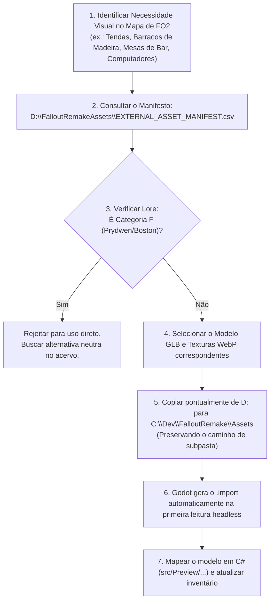

# Guia Operacional de Consulta e Recuperação de Assets (Codex & Claude)

> **Destinatários:** Agentes de IA (Codex, Claude, Gemini) e Desenvolvedores de FalloutRemake  
> **Finalidade:** Procedimento normativo para localizar, selecionar e transferir modelos 3D do repositório externo `D:\FalloutRemakeAssets` para o projeto Godot `C:\Dev\FalloutRemake\Assets` durante a construção de novos mapas, cenários e sistemas.

---

## 1. Princípio de Projeto: "On-Demand Only" (Apenas Sob Demanda)

O projeto `FalloutRemake` adota uma política de repositório de assets enxuto:
- O projeto Godot (`C:\Dev\FalloutRemake\Assets`) contém **apenas os assets estritamente necessários** para as cenas e sistemas ativos.
- O repositório externo (`D:\FalloutRemakeAssets`) funciona como a **biblioteca mestra de reserva**, contendo mais de 5.760 modelos 3D homologados e dezenas de milhares de texturas PBR.
- **Regra Fundamental:** Nunca copie pastas inteiras de volta para o Godot. Copie arquivo a arquivo, somente os modelos necessários para o cenário que está sendo construído.

---

## 2. Fluxo de Trabalho Passo a Passo para Novos Mapas

Quando Codex ou Claude forem construir um novo mapa (ex.: Klamath, The Den, Modoc, Vault City ou interiores do Templo):



---

## 3. Estrutura de Diretórios do Repositório Externo

Em `D:\FalloutRemakeAssets`, os arquivos estão organizados pelas categorias temáticas originais:

```text
D:\FalloutRemakeAssets\
├── Architecture\           (Mais de 2.250 modelos de construção e estruturas)
│   ├── RetainingWall\      (Muros de cantaria pesada, granito, poços, blocos)
│   ├── Shacks\             (Barracos de madeira, tábuas podres, telhados de zinco - ideal para Klamath)
│   ├── Shantytown\         (Estruturas improvisadas de sucata e lona)
│   ├── Vault\              (Módulos completos de Vault pré-guerra - ideal para Vaults 13 e 15)
│   ├── Industrial\         (Caldeiras pesadas, vigas de aço, passarelas - ideal para Gecko)
│   ├── SteamTunnels\       (Tubulações subterrâneas, válvulas, drenos)
│   └── HighTech\           (Pisos técnicos e painéis limpos - ideal para Vault City)
├── Containers\             (Baús rústicos, caixotes de madeira, armários, cofres)
├── Furniture\              (Mesas de bar, cadeiras, camas, estantes, balcões)
├── Nature\                 (Árvores secas, rochas vermelhas, arbustos do deserto, folhagem árida)
├── Props\                  (Mais de 1.700 adereços cênicos, entulho, placas, consoles, iluminação)
│   ├── Encampment\         (Fogueiras, totens com crânios, panelas rústicas, sacos de dormir)
│   ├── Rubble\             (Entulho de alvenaria, escombros, pilhas de tijolos, esqueletos)
│   └── Lighting\           (Arandelas de parede, lâmpadas industriais, tochas)
├── ProjectMojave\          (905 modelos desérticos de FNV: cânions, cliffs, cactos, ruínas de adobe)
│   ├── Environment\Cliffs\ (Paredes de penhasco gigantescas e fendas de cânion)
│   └── Environment\Rocks\  (Matacões de granito e arenito vermelho do deserto)
├── Vehicles\               (Carcaças enferrujadas de carros Highwayman, caminhões, tratores)
└── _Catalog\               (vanilla_manifest.csv com o histórico e notas de cada lote)
```

---

## 4. Script Auxiliar de Recuperação Rápida

Para facilitar a cópia segura de um modelo e suas texturas sem erros manuais, os agentes podem executar o script PowerShell local:

```powershell
# Exemplo: Recuperar um modelo de barraco de madeira para Klamath
powershell -File tools/Restore-Asset.ps1 -ModelRelativePath "Architecture/Shacks/ShackWoodWall01.glb"
```

O comando copia o arquivo `.glb`, localiza todas as texturas associadas (`_d.webp`, `_n_normal_gl.webp`, `_orm.webp`) e as coloca no local exato em `C:\Dev\FalloutRemake\Assets\Architecture\Shacks\`.

---

## 5. Regras Críticas de Operação para os Agentes

1. **Respeito à Regra 1 de `AGENTS.md` (Validação sem interferência):**
   - Nunca abra o Godot com janela normal no desktop do usuário.
   - Use `--headless` ou `tools/Run-QuietGodot.ps1` para validar novas cenas e modelos.
2. **Respeito à Lore de Fallout 2:**
   - Consulte sempre [`docs/REGISTRO_EXCLUSOES_LORE_FALLOUT4.md`](file:///c:/Dev/FalloutRemake/docs/REGISTRO_EXCLUSOES_LORE_FALLOUT4.md) antes de selecionar um modelo com temática militar moderna ou cívica da Costa Leste.
   - Assets da Prydwen, monumentos cívicos de Boston e tecnologia asséptica do Instituto são expressamente proibidos para uso em Fallout 2.
3. **Atualização da Documentação:**
   - Sempre que um asset for promovido de `D:\FalloutRemakeAssets` para `C:\Dev\FalloutRemake\Assets`, registre a adição em [`docs/INVENTARIO_DEPENDENCIAS_GODOT.md`](file:///c:/Dev/FalloutRemake/docs/INVENTARIO_DEPENDENCIAS_GODOT.md).
