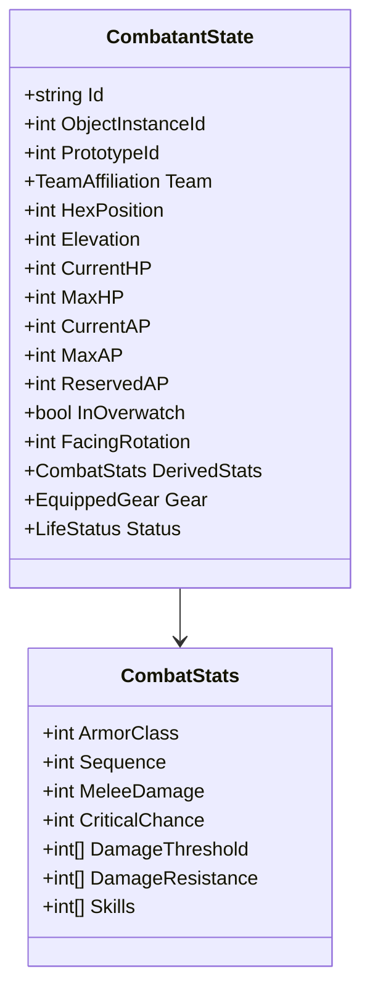

# FalloutRemake — Especificação Funcional e Técnica do Combate Tático Modernizado

> **Status:** Especificação de Produto e Arquitetura de Domínio  
> **Data de Elaboração:** 28 de Outubro de 2026  
> **Autor da Análise:** Gemini Flash 3.8 (Agente Solo)  
> **Base de Código:** Commit `a66f31c`  
> **Referência Técnica Clássica:** Fallout 2 Community Engine (CE) — `combat.cc`, `item.cc`, `proto.h`  
> **Documento Principal:** [gameplay-combat-roadmap.md](file:///c:/Dev/FalloutRemake/docs/roadmap/gameplay-combat-roadmap.md)

---

## 1. Princípios de Design e Pilares do Combate

O combate do **FalloutRemake** é concebido como um RPG tático isométrico por turnos em grid hexagonal. O objetivo é honrar a profundidade matemática de Fallout 2 eliminando as opacidades e frustrações ergonômicas dos anos 90 através de pré-visualizações ricas, ritmo acelerado e decisões posicionais expressivas.

### Os Três Pilares:
1. **Fidelidade às Regras Clássicas de RPG:** A progressão de atributos SPECIAL, habilidades percentuais, pontos de ação, armaduras com DT/DR e tabelas de críticos por parte do corpo são a espinha dorsal matemática do sistema.
2. **Transparência e Previsibilidade:** O jogador nunca deve se perguntar "por que errei?" ou "quanto de dano esperar?". A interface explica detalhadamente todas as variáveis de uma ação antes de sua confirmação.
3. **Decisões Táticas Espaciais:** Posicionamento, uso consciente de coberturas, linhas de visão limpas e postura de overwatch transformam o mapa em uma arena tática ativa.

---

## 2. Estado do Combatente (`CombatantState`)

O modelo de dados de um participante de combate é puramente desacoplado do Godot, residindo em `src/Runtime/Combat/`.



### Atributos Secundários Derivados (Fórmulas Clássicas CE)
- **Hit Points Máximos:** $\text{MaxHP} = 15 + \text{ST} + (2 \times \text{EN}) + (\text{Nível} - 1) \times (2 + \lfloor\text{EN}/2\rfloor)$.
- **Action Points (AP):** $\text{BaseAP} = 5 + \lfloor\text{AG}/2\rfloor$.
- **Classe de Armadura (AC):** $\text{BaseAC} = \text{AG} + \text{Armor AC Mod}$.
- **Iniciativa (Sequence):** $\text{Sequence} = 2 \times \text{PE}$.
- **Dano Corpo a Corpo (Melee Dmg):** $\text{MeleeDamage} = \max(1, \text{ST} - 5)$.
- **Chance Crítica Base:** $\text{CriticalChance} = \text{LK}\%$.

---

## 3. Gestão de Turnos, Rodadas e Iniciativa

### 3.1. Rolagem de Iniciativa
Ao iniciar o combate, todos os participantes na zona de engajamento são ordenados por iniciativa:
$$\text{Score de Iniciativa} = \text{Sequence} + \text{Desempate D6}$$
- **Desempates:**
  1. Maior valor de Agilidade ($\text{AG}$).
  2. Maior valor de Percepção ($\text{PE}$).
  3. Maior valor de Sorte ($\text{LK}$).
  4. Semente pseudo-aleatória determinística da sessão de combate.

### 3.2. Estrutura da Rodada
- Uma **Rodada** completa-se quando todos os combatentes ativos tiveram seu turno.
- No início do turno de um combatente:
  - Seus APs são restaurados para o $\text{MaxAP}$.
  - Efeitos temporários de início de turno (veneno, sangramento, atordoamento) são aplicados.
  - Se estiver atordoado ou nocauteado, consome o turno para recuperação.
- No encerramento do turno:
  - APs restantes não alocados para Overwatch contribuem para a defesa imediata (+1 AC para cada AP não gasto, conforme a regra original clássica).
  - Se o jogador ativou a postura de Overwatch, os APs reservados são bloqueados para a reação.

---

## 4. Movimentação Tática no Grid Hexagonal

- **Custo Básico de AP:** Cada hexágono transitado consome **1 AP**.
- **Bloqueio e Ocupação:**
  - Não é permitido atravessar hexágonos ocupados por outros combatentes vivos ou bloqueadores sólidos (`HexNavigation.Valid` e `Walkable`).
  - Passar ao lado de inimigos em combate fechado **não** gera ataques de oportunidade por padrão em Fallout 2 (salvo sob o novo sistema de Overwatch, que vigia zonas ativas).
- **Alcance de Movimento:**
  - $\text{Hexes Alcançáveis} = \min(\text{CurrentAP}, \text{Distância Máxima BFS})$.

---

## 5. Resolução de Ataque e Chance de Acerto (To Hit)

A probabilidade percentual de acerto segue a lógica clássica com modificadores posicionais modernos:

$$\text{Chance de Acerto (\%)} = \text{Perícia Relevante} + \text{Bônus da Arma} - \text{AC do Alvo} - \text{Penalidade de Distância} + \text{Modificador de Percepção} - \text{Penalidade de Luz} - \text{Penalidade de Cobertura} - \text{Penalidade da Parte do Corpo}$$

### 5.1. Limites Absolutos (Clamping)
- **Mínimo:** 5% (salvo em caso de linha de tiro 100% bloqueada, onde o disparo é inválido: 0%).
- **Máximo:** 95% (preservando o princípio original do Fallout em que rolagens no d100 de 96–100 são sempre erros).

### 5.2. Modificadores Detalhados
- **Penalidade de Distância:**
  - Armas de alcance: $-3\%$ por hexágono além do alcance ótimo da arma.
  - Modificador de Percepção: $+(\text{PE} - 2) \times 4\%$ para compensar distância.
- **Penalidade de Iluminação:**
  - Ambiente escuro: até $-40\%$ de penalidade na ausência de fontes de luz (tochas, lâmpadas, Night Vision).

---

## 6. Cobertura Posicional (Cover System)

A cobertura é uma modernização que traduz geometricamente as barreiras e objetos do cenário em proteção tática para o alvo.

```text
[Atacante] ------------ Linha de Tiro (Raycast) ------------> [Hex de Cobertura] -> [Alvo]
                                                             (Muro baixo/Pedra)
```

### 6.1. Tipos de Cobertura
1. **Sem Cobertura:** Vetor de tiro livre de obstáculos nos hexes adjacentes ao alvo. Sem modificadores.
2. **Meia Cobertura (Half Cover):** Obstáculo na altura da cintura (muretas de pedra, caixotes baixos, troncos caídos) intercepta o ângulo de ataque.
   - **Efeito:** $-20\%$ na Chance de Acerto do atacante e $+10$ de Classe de Armadura (AC) efetiva do alvo.
3. **Cobertura Total (Full Cover):** Obstáculo alto (paredes de caverna, colunas de pedra, portas de ferro fechadas) cobre integralmente o alvo.
   - **Efeito:** Se o obstáculo estiver no hex adjacente e bloquear o cone de visão, a linha de tiro é **inválida (0%)**. Se for uma cobertura com quina (peek-out), impõe $-40\%$ na Chance de Acerto.

### 6.2. Algoritmo Geométrico de Cobertura
1. Traça-se um segmento no espaço cartesiano 3D entre o centro do hex do Atacante e o centro do hex do Alvo (`FalloutGrid.HexCenter`).
2. Identificam-se os hexágonos vizinhos do alvo (`FalloutGrid.Neighbor`, direções 0 a 5) que intersectam o segmento.
3. Se algum desses hexágonos contiver um objeto sólido de cenário (`Scenery` com flag de bloqueio ou parede) cuja elevação obstrua o arco do projétil, a cobertura correspondente é atribuída.

---

## 7. Modos de Ataque

### 7.1. Ataque Simples (Single Shot / Strike)
- **Custo de AP:** Definido pelo protótipo da arma (ex.: Soco/Chute = 3 AP; Estocada com Lança = 4 AP; Pistola 10mm = 5 AP).
- **Alvo:** Centro de massa do inimigo (Tronco).
- **Sem penalidade de região corporal.**

### 7.2. Ataque Mirado por Região Corporal (Targeted Shots)
O jogador gasta **+1 AP adicional** para visar pontos vitais do corpo da criatura.

| Região Corporal | Penalidade de Acerto | Custo Adicional | Multiplicador de Crítico | Efeitos Especiais de Crítico |
| :--- | :---: | :---: | :---: | :--- |
| **Olhos** | **-60%** | +1 AP | 3.0x | Cegueira permanente, perda maciça de PE, chance alta de morte instantânea |
| **Cabeça** | **-40%** | +1 AP | 2.5x | Concussão, nocaute por 1–3 turnos, redução de IN e PE |
| **Virilha** | **-30%** | +1 AP | 2.0x | Derrubada, nocaute por 1 turno, perda imediata de 5 APs |
| **Braço Esquerdo / Direito** | **-30%** | +1 AP | 1.5x | Membro aleijado, derruba arma em mãos, incapacidade de empunhar armas de duas mãos |
| **Perna Esquerda / Direita** | **-20%** | +1 AP | 1.5x | Membro aleijado, queda imediata, penalidade severa de movimentação (custo de +3 AP/hex) |
| **Tronco** | **0%** | 0 AP | 1.0x | Dano padrão sem modificador crítico adicional |

### 7.3. Disparo em Rajada (Burst Fire)
- **Custo de AP:** Geralmente +1 ou +2 APs acima do tiro simples da arma (ex.: 10mm SMG = 5 AP para simples, 6 AP para rajada).
- **Consumo de Munição:** Consome uma taxa fixa de projéteis (ex.: 10mm SMG dispara 10 tiros por rajada).
- **Cone Geométrico de Dispersão:**
  - O tiro abre um cone angular a partir da boca da arma até o alcance máximo.
  - Alvos no centro do cone recebem a maior probabilidade de múltiplos impactos.
  - Alvos nas bordas do cone recebem projéteis dispersos.
- **Fogo Amigo (Friendly Fire):** Aliados situados dentro do cone de rajada são tratados exatamente como alvos em potencial.
- **Trava de Confirmação:** Se um companheiro estiver no cone de risco com probabilidade de impacto $> 5\%$, a interface emite alerta sonoro/visual e exige confirmação explícita do jogador.

---

## 8. Sistema de Overwatch e Ataques de Reação

Modernização tática inspirada em referências clássicas como *Jagged Alliance* e *XCOM*.

### 8.1. Mecânica de Ativação
- O combatente encerra seu turno mantendo **APs reservados** suficientes para disparar sua arma primária (ex.: reserva de 4 AP para estocada de lança ou 5 AP para tiro de pistola).
- O jogador define um **Arco de Vigilância** (ângulo cônico de 60° a 180° orientado a uma direção do grid).

### 8.2. Gatilho de Reação
- Um inimigo entra no campo de visão e alcance da arma dentro do arco de vigilância durante seu próprio turno.
- O movimento do inimigo é **interrompido temporariamente**.
- O atacante executa um tiro de reação com uma penalidade de $-15\%$ na chance de acerto (devido à natureza reflexiva do disparo).
- **Resolução:**
  - Se o ataque acertar e causar dano paralisante (nocaute, aleijamento de perna), o inimigo perde os APs restantes e para no hex onde foi alvejado.
  - Se errar ou causar dano comum sem efeito paralisante, o inimigo retoma os APs restantes e completa o movimento planejado.
- **Limite:** Cada combatente pode executar no máximo **1 reação de overwatch por rodada**.

---

## 9. Armaduras, Limiares, Resistências e Dano

### 9.1. Tipos de Dano
1. **Normal (Balístico / Contundente / Cortante)**
2. **Laser**
3. **Fogo**
4. **Plasma**
5. **Elétrico**
6. **EMP (Eletromagnético — afeta robôs/eletrônicos)**
7. **Explosão**

### 9.2. Fórmula de Cálculo de Dano
Para cada impacto:
1. **Dano Bruto:** Sorteado entre o intervalo mínimo e máximo da arma ($\text{MinDmg} \dots \text{MaxDmg}$) somado ao bônus de Melee Damage do atacante (para armas brancas/desarmado).
2. **Subtração de Limiar de Dano (Damage Threshold - DT):**
   $$\text{Dano Pós-DT} = \max(0, \text{Dano Bruto} - \text{DT})$$
3. **Aplicação de Resistência a Dano (Damage Resistance - DR %):**
   $$\text{Dano Efetivo} = \lfloor \text{Dano Pós-DT} \times (1 - \frac{\text{DR}}{100}) \rfloor$$
4. **Subtração de HP:**
   $$\text{HP Final} = \text{CurrentHP} - \text{Dano Efetivo}$$

### 9.3. Hipótese de Balanceamento: Piso de Dano Mínimo Efetivo
> [!NOTE]
> **Proposta Técnica sob Avaliação (Decisão Pendente DEC-004):**  
> No Fallout 2 original, se o dano bruto for inferior ao DT da armadura, o dano resultante é exatamente zero (`0 HP`). Isso frequentemente tornava armas leves completamente inúteis contra inimigos blindados.  
> Avalia-se implementar um **Piso Mínimo de Dano Efetivo**: em qualquer ataque que acerte com sucesso, pelo menos **10% do dano bruto (ou mínimo 1 HP)** atravessa a armadura na forma de "impacto contundente/cinético", impedindo a anulação matemática total do ataque.  
> *Esta regra está registrada como decisão pendente e não será ativada sem aprovação explícita.*

---

## 10. Sistema de Pré-Visualização de Ações (Action Preview)

A pré-visualização é uma das modernizações mais críticas do projeto. O jogador visualiza exatamente o que acontecerá antes de gastar seus APs.

```text
┌────────────────────────────────────────────────────────┐
│ PREVISÃO DE DISPARO — Formiga Gigante (Hex 14220)       │
├────────────────────────────────────────────────────────┤
│ Probabilidade de Acerto: 68%                           │
│  ├─ Perícia Unarmed:             +45%                  │
│  ├─ AC do Alvo (Formiga):         -4%                  │
│  ├─ Bônus de Curta Distância:    +12%                  │
│  ├─ Penalidade de Meia Cobertura: -20% (Pedra Baixa)   │
│  └─ Visibilidade de Luz:          +35%                 │
├────────────────────────────────────────────────────────┤
│ Dano Estimado: 4 – 9 HP (Normal)                       │
│  ├─ Dano Bruto: 4 – 9 | DT Alvo: 0 | DR Alvo: 0%       │
│  └─ Dano Esperado Médio: 6.5 HP                        │
├────────────────────────────────────────────────────────┤
│ Custo em AP: 4 AP | APs Restantes após Ação: 3 AP      │
│ Linha de Tiro: DESOBSTRUÍDA (1 obstáculo parcial)      │
│ Risco de Fogo Amigo: NENHUM                            │
└────────────────────────────────────────────────────────┘
```

### Regras do Motor de Pré-Visualização:
- **Reutilização de Código:** O mesmo método de domínio (`CombatResolver.CalculateToHit` e `CombatResolver.CalculateProjectedDamage`) é utilizado para exibir a previsão na UI e para resolver o disparo real. Isso garante **zero discrepância** entre o que é prometido na tela e o que é sorteado nos dados.

---

## 11. Primeira Fatia Vertical: Duelo 1v1 contra Formiga Gigante

Para comprovar a integração de ponta a ponta sem riscos de sobrecarga de escopo, a primeira fatia vertical de combate é restrita e delimitada.

### Especificação do Encontro
- **Localização:** `maps/arcaves.map` (Templo das Provações), Elevação 0, Primeira Câmara.
- **Inimigo:** **Formiga Gigante** (`0x0100017E` / PID 382, PRO `00000382.pro`).
  - HP: 18 | AP: 7 | AC: 4 | Sequence: 50 | Unarmed: 25%.
  - DT: 0 | DR: 0% para todos os tipos.
  - Recompensa ao morrer: **25 XP**.
- **Jogador:** The Chosen One (Perfil Neutro).
  - HP: 30 | AP: 7 | AC: 5 | Sequence: 10 | Unarmed: 35% / Lança (PID 7, dano 3–10, 4 AP).
- **Objetivos de Homologação:**
  1. O jogador aproxima-se a 5 hexes da formiga $\to$ Modo de combate inicia.
  2. Iniciativa rola (Formiga com 50 Sequence age primeiro).
  3. Formiga gasta 3 APs para andar 3 hexes e 3 APs para tentar uma mordida.
  4. Turno passa ao jogador com 7 APs cheios.
  5. Jogador passa o mouse na formiga: HUD exibe a pré-visualização (chance ~65%, dano esperado ~6 HP, custo 4 AP).
  6. Jogador clica e ataca com lança $\to$ Acerto sorteado $\to$ Formiga perde 7 HP (fica com 11 HP).
  7. Jogador encerra o turno.
  8. No turno seguinte, jogador finaliza a formiga.
  9. Formiga toca animação de morte, colisor torna-se passável (cadáver), jogador recebe 25 XP no HUD e a sessão de combate encerra retornando à exploração normal.
