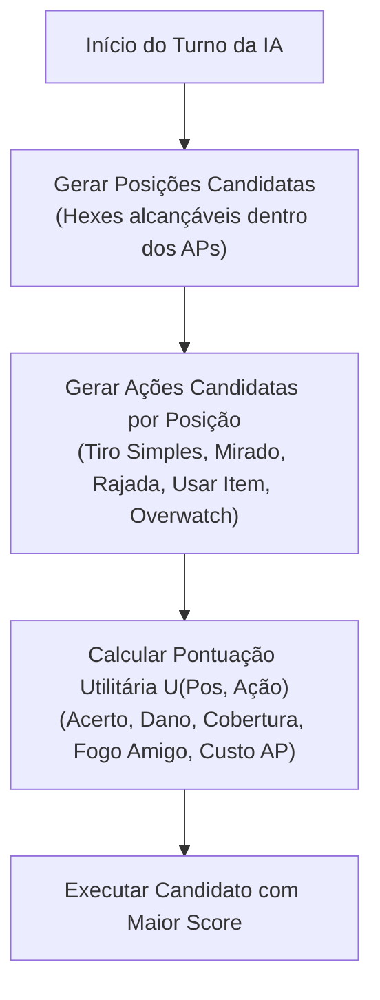

# FalloutRemake — Companions, Controle de Grupo e Inteligência Artificial Tática

> **Status:** Especificação de Produto e Arquitetura de Domínio  
> **Data de Elaboração:** 28 de Outubro de 2026  
> **Autor da Análise:** Gemini Flash 3.8 (Agente Solo)  
> **Base de Código:** Commit `a66f31c`  
> **Referência Histórica:** sfall Full Party Control, Wasteland 3, Jagged Alliance 3  
> **Documento Principal:** [gameplay-combat-roadmap.md](file:///c:/Dev/FalloutRemake/docs/roadmap/gameplay-combat-roadmap.md)

---

## 1. Filosofia de Design dos Companions

No Fallout 2 clássico, companions (como Sulik, Vic, Cassidy e Goris) operavam exclusivamente por scripts autônomos de IA. Isso frequentemente resultava em desastres táticos clássicos, como Sulik disparando rajadas de SMG nas costas do jogador ou aliados bloqueando portas estreitas.

O **FalloutRemake** redefine essa dinâmica com um princípio moderno fundamental:
> **Controle Direto de Companions por Padrão (Full Party Control)**, com **Inteligência Artificial Tática (Utility AI) configurável como modo opcional**.

O jogador tem o poder de decidir se deseja microgerenciar minuciosamente cada passo de seus aliados ou delegar o controle a uma IA utilitária orientada a papéis táticos que respeita estritamente a segurança do grupo.

---

## 2. Controle Direto de Grupo (Modo Padrão)

### 2.1. Seleção e Alternância de Personagens
- **Ordem de Iniciativa Individual:** Cada companion rola sua própria iniciativa com base em sua estatística de `Sequence`.
- **Janela de Ação:** Quando a iniciativa alcança um companion no turno do jogador:
  - A câmera foca suavemente no personagem ativo.
  - A barra de HUD adapta-se exibindo a Força, Agilidade, HP, AP e armas equipadas daquele companion específico.
  - O jogador move o companion, troca de arma, consome itens da bolsa ou ataca utilizando os APs daquele aliado.
- **Passagem de Turno:** O jogador pode encerrar o turno do companion com a tecla de espaço (`Space`) ou botão correspondente no gamepad, avançando a timeline de iniciativa para o próximo combatente.

### 2.2. Tratamento de Companions sem Comando
- Se o tempo de turno expirar (em modos competitivos/com cronômetro opcional) ou se o jogador optar por não agir, os APs restantes são automaticamente convertidos no bônus defensivo de AC (+1 AC por AP).

---

## 3. Modo Opcional: Inteligência Artificial Utilitária (Utility AI)

O jogador pode alternar individualmente qualquer companion para o **Modo Autônomo** através de um seletor no HUD ou na tela de gerenciamento de grupo. A mesma arquitetura de IA é utilizada para controlar inimigos e criaturas hostis.

### 3.1. Arquitetura de Pontuação de Candidatos
Em vez de árvores de comportamento rígidas baseadas em estados fixos, a IA avalia todos os pares viáveis de `(Posição Candidata, Ação Candidata)` e seleciona o par de maior pontuação utilitária global ($U$).

### 3.2. Função de Pontuação Utilitária ($U$)
Para cada combinação $(p, a)$:
$$U(p, a) = w_{hit} \cdot P(hit) + w_{dmg} \cdot \mathbb{E}[Dano] + w_{cov} \cdot Score(Cob) - w_{ap} \cdot CustoAP - w_{risco} \cdot RiscoExposicao - w_{ff} \cdot RiscoFogoAmigo$$

Onde:
- $P(hit)$: Probabilidade calculada de acerto (0.0 a 1.0).
- $\mathbb{E}[Dano]$: Dano esperado após dedução de DT e DR do alvo.
- $Score(Cob)$: Bônus posicional de proteção (0 para aberto, 0.5 para meia cobertura, 1.0 para cobertura total).
- $CustoAP$: Razão de AP consumido pelo AP disponível.
- $RiscoExposicao$: Proximidade de múltiplos inimigos sem cobertura adequada.
- $RiscoFogoAmigo$: Penalidade massiva se aliados estiverem no cone ou adjacência de impacto.

---

## 4. Papéis Táticos (Tactical Roles)

O jogador pode designar uma postura tática para cada companion autônomo, alterando os pesos ($w$) da função utilitária:

| Papel Tático | $w_{hit}$ | $w_{dmg}$ | $w_{cov}$ | $w_{ff}$ | Comportamento Observado |
| :--- | :---: | :---: | :---: | :---: | :--- |
| **Atirador (Sniper)** | Alto | Médio | Muito Alto | Máximo | Mantém distância máxima, prioriza posições elevadas e coberturas totais; nunca arrisca rajadas. |
| **Linha de Frente (Frontline)** | Médio | Alto | Médio | Alto | Avança em direção a alvos vulneráveis, bloqueia passagens estreitas e absorve atenção inimiga. |
| **Suporte / Médico (Support)** | Médio | Baixo | Alto | Máximo | Prioriza uso de Stimpaks e Primeiros Socorros em aliados com HP $< 50\%$; finaliza inimigos enfraquecidos. |
| **Cauteloso (Cautious)** | Alto | Baixo | Extremo | Extremo | Recua se inimigos se aproximarem a menos de 4 hexes; prefere encerrar turno com Overwatch e cobertura alta. |

---

## 5. Aversão a Fogo Amigo (Friendly Fire Evaluation)

A IA de companions possui uma restrição matemática estrita contra fogo amigo em disparos de rajada e explosivos:

1. **Cálculo de Projeção Geométrica:**
   - Para qualquer disparo em cone (rajada) ou área de efeito (granadas), todos os hexágonos afetados são mapeados.
2. **Avaliação Probabilística:**
   - Não basta verificar se um aliado está no hex central. A IA calcula a dispersão de projéteis perdidos.
   - Se a probabilidade de um aliado sofrer qualquer dano for superior a **0%**, aplica-se uma penalidade proibitiva:
     $$w_{ff} \cdot RiscoFogoAmigo = -10.000 \text{ pontos}$$
   - Isso zera a utilidade da ação de rajada, forçando a IA a optar por um **tiro simples mirado** ou reposicionamento.

---

## 6. Painel de Depuração da IA (AI Transparency & Debugging)

Para desenvolvimento, balanceamento e transparência perante o jogador, é implementado o painel de inspeção de decisões:
- **Exibição em Tempo Real:** Pressionar `F11` durante o turno de uma IA abre uma sobreposição visual mostrando:
  - Os 5 melhores candidatos avaliados.
  - O detalhamento dos termos da fórmula ($w_{hit}, w_{dmg}, w_{cov}$, etc.).
  - Vetores de linha de tiro e cones de perigo projetados no grid 3D.
  - A justificativa da ação vencedora (ex.: *"Optou por recuar para Hex 15420 (Meia Cobertura) e aplicar Tiro Simples devido a 82% de acerto"*).

---

## 7. Inventários e Loadouts dos Companions

### 7.1. Gerenciamento Individual
- Cada companion possui seu próprio vetor de inventário (`CarriedItem[]`), capacidade máxima de carga baseada em sua Força (`CarryWeight`), e slots dedicados de equipamento:
  - **Mão Principal (Arma Primária)**
  - **Mão Secundária (Arma Secundária / Escudo)**
  - **Armadura Corporal (Slot de Armadura)**
- **Regras de Compatibilidade:**
  - O companion só pode empunhar armas cuja Força mínima exigida seja atendida ($\text{Força do Companion} \ge \text{MinST da Arma}$).
  - Armaduras requerem compatibilidade com o tipo de corpo e FID de animação do modelo 3D.

### 7.2. Sistema de Loadouts Salvos
- O jogador pode salvar perfis de equipamento (ex.: *"Loadout de Combate Noturno"*, *"Loadout de Combate Fechado"*).
- Ao aplicar um loadout:
  - O sistema valida atomicamente a disponibilidade dos itens na bolsa do grupo.
  - Se faltar munição ou o item foi perdido, emite aviso transparente sem corromper o estado do personagem.

### 7.3. Persistência de Dados
- As preferências de controle (Manual vs IA), papéis táticos escolhidos e o inventário de cada companion são salvos de forma determinística no arquivo `WorldCheckpoint` dentro da estrutura multi-mapa.
