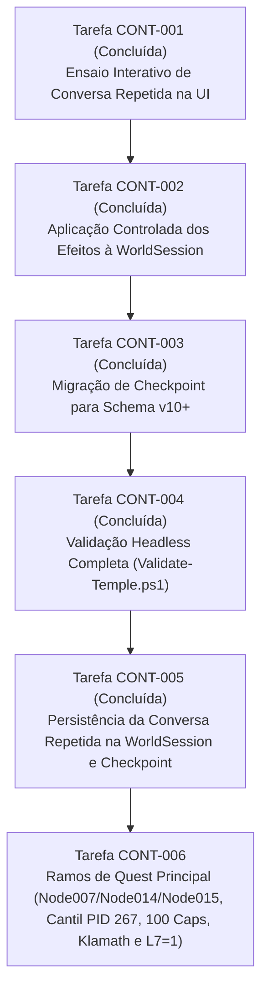
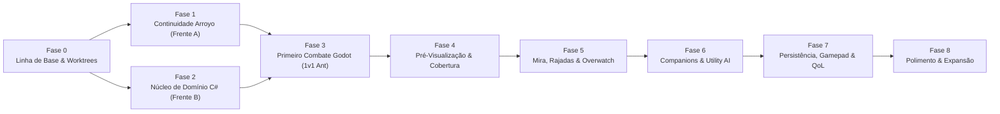

# FalloutRemake — Roadmap Geral de Gameplay, Continuidade e Combate Modernizado

> **Status:** Documento Canônico de Planejamento e Arquitetura (Atualizado em 02/11/2026)  
> **Data de Elaboração:** 28 de Outubro de 2026  
> **Autor da Análise:** Gemini Flash 3.8 (Agente Solo)  
> **Base de Código Verificada:** Commit `fe99d18` (`codex/arroyo-elder-entry-audit`)  
> **Repositório Principal:** `D:\Dev\FalloutRemake`  
> **Acervo Externo de Assets:** `D:\FalloutRemakeAssets`  
> **Ambientes de Desenvolvimento Isolados:** `D:\Dev\FalloutRemakeArgon`, `D:\Dev\FalloutRemakeCodex`, `D:\Dev\FalloutRemakeClaude`, `D:\Dev\FalloutRemakeIntegracao`  
> **Documentos Complementares:**
> - [combat-functional-specification.md](file:///D:/Dev/FalloutRemake/docs/roadmap/combat-functional-specification.md)
> - [companions-and-tactical-ai.md](file:///D:/Dev/FalloutRemake/docs/roadmap/companions-and-tactical-ai.md)
> - [tactical-ui-and-qol.md](file:///D:/Dev/FalloutRemake/docs/roadmap/tactical-ui-and-qol.md)
> - [parallel-work-packages.md](file:///D:/Dev/FalloutRemake/docs/roadmap/parallel-work-packages.md)
> - [architecture-and-design-decisions.md](file:///D:/Dev/FalloutRemake/docs/roadmap/architecture-and-design-decisions.md)
> - [requirements-traceability.md](file:///D:/Dev/FalloutRemake/docs/roadmap/requirements-traceability.md)

---

## 1. Resumo Executivo

Este documento consolida o **Roadmap Técnico Geral** do projeto `FalloutRemake`, abrangendo **todas as frentes de desenvolvimento ativas, pendentes e futuras**. A estratégia adotada concilia duas necessidades vitais:

1. **Continuidade das Features Existentes (Frente A):** Retomada imediata dos sistemas iniciados (diálogos, interação com a Anciã de Arroyo, persistência de variáveis e scripts recuperados do Fallout 2 original).
2. **Combate Tático Modernizado (Frente B):** Introdução estruturada e progressiva de um sistema de combate em turnos no grid hexagonal que respeite os fundamentos originais de Fallout 2 (SPECIAL, habilidades, AP, armas, armaduras, DT/DR e críticos por região corporal) e incorpore melhorias de qualidade de vida e referências táticas modernas (pré-visualização de ações, cobertura posicional, overwatch, controle direto de companions e ritmo dinâmico).

A análise foi conduzida de forma autônoma e independente por **Gemini Flash 3.8**, fundamentando cada afirmação em arquivos, classes, métodos e dados inspecionados diretamente no repositório.

---

## 2. Inventário e Estado Real das Frentes do Projeto

Abaixo é apresentada a classificação rigorosa de cada subsistema do projeto, conforme a escala de 6 níveis obrigatória:
1. **Implementado e confirmado:** Existe código ativo e seu comportamento foi verificado em testes.
2. **Dados disponíveis:** Os dados originais foram importados ou podem ser lidos, mas a lógica de uso não está implementada.
3. **Parcialmente implementado:** Existe uma parte funcional, mas faltam componentes essenciais para o fluxo completo.
4. **Documentado, sem implementação confirmada:** Consta em relatórios, mas não possui código ativo verificado.
5. **Ausente:** A funcionalidade necessária ainda não existe no código.
6. **Não verificável:** Não foi possível confirmar por restrições operacionais ou falta de ambiente.

### Tabela Geral de Subsistemas

| Frente / Subsistema | Classificação Real | Evidências no Código / Testes | Descrição do Estado Real |
| :--- | :--- | :--- | :--- |
| **Leitura de Formatos Originais** | **Implementado e confirmado** | `src/Import/DatArchive.cs`, `MapDocument.cs`, `CritterPrototypeData.cs`, `WeaponPrototypeData.cs`, `ArmorPrototypeData.cs`, `AmmoPrototypeData.cs`, `DrugPrototypeData.cs`, `CharacterFile.cs`, `AiPacketCatalog.cs`, `IntProgram.cs`, `MapLayoutWriter.cs` | Leitura determinística de DAT, MAP, PRO, GAM, MSG, FRM, GCD, AI e opcodes INT. 476 grupos de testes sintéticos aprovados em `TempleInspector`. |
| **Grid Hexagonal e Matemática** | **Implementado e confirmado** | `src/Geometry/FalloutGrid.cs` | 40.000 hexágonos (200x200), conversão afim 3D/hex, cálculo de distância topológica e identificação de 6 vizinhos. |
| **Pathfinding e Navegação** | **Implementado e confirmado** | `src/Geometry/HexNavigation.cs`, `OriginalPathfinder.cs`, `OriginalStraightPath.cs` | BFS e pathfinder CE com bloqueadores multihex, suporte a 3 elevações (0, 1, 2) e políticas de saída (`StopAtExits`, `ContinueAcrossExits`). |
| **Sessão e Checkpoints (v1 a v13)** | **Implementado e confirmado** | `src/Runtime/WorldSession.cs`, `WorldCheckpoint.cs`, `AtomicFileReplacement.cs` | Persistência multi-mapa em JSON atômico ($\le$ 1 MB) com migração retroativa de versões anteriores e validação estrita (`v1`–`v13`). |
| **Portas, Chaves e Lockpick** | **Implementado e confirmado** | `src/Runtime/TempleDoorAdapter.cs`, `DoorSession.cs`, `PrototypeCharacter.cs` | Abertura/fechamento, arrombamento (Lockpick 9) com 25 XP únicos e porta 100 da vila desbloqueável via tecla U. |
| **Explosivos e Barreira** | **Implementado e confirmado** | `src/Runtime/ExplosiveTimer.cs`, `TempleBarrierProjection.cs` | Dinamite com timer lógico (+1s/+10s), detonação atômica, remoção do bloqueador da barreira do Templo e abertura do caminho para Elevação 2. |
| **Inventário, Peso e Contêineres** | **Implementado e confirmado** | `src/Runtime/ItemTransferSession.cs`, `CarryWeight.cs`, `ItemOriginRoute.cs` | Coleta rápida ("Take All") e devolução integral ("Return All") com limite estrito de peso por Força. Itens rastreados por origem. |
| **Speech do Templo (Cameron)** | **Implementado e confirmado** | `src/Runtime/TempleSpeechDraft.cs`, `WorldTempleSpeech.cs`, `TempleNpcDeparture.cs` | Rota diplomática de 5 escolhas (`actemvil.int`), partida física do NPC e abertura da porta para a vila de Arroyo. |
| **Transição para Arroyo e Recompensas**| **Implementado e confirmado** | `src/Runtime/TempleVillageRoute.cs`, `ArroyoRewardProfile.cs` | Saída pela porta 100 para o mapa 4 (`arvillag.map`), concessão única de recompensa, Karma e Reputação de Arroyo persistidos no checkpoint. |
| **Aproximação da Anciã (Elder)** | **Implementado e confirmado** | `src/Preview/ArroyoElderApproachChecks.cs`, `ArroyoElderApproach.cs` | Rota guiada do personagem até o hex adjacente à Anciã (Tile 18915) na Elevação 0 de Arroyo. |
| **Consulta de Diálogo da Anciã** | **Implementado e confirmado (`CONT-001`)** | `src/Runtime/ArroyoElderConsultation.cs`, `src/Preview/ArroyoElderConsultationChecks.cs` | Ensaio interativo funcional exibindo mensagens originais de `ahelder.msg` tanto para o primeiro diálogo (`Node001`) quanto para a conversa repetida (`Node004`). |
| **Auditoria da Conversa Repetida** | **Implementado e confirmado (`CONT-001`)** | `tools/TempleInspector/ArroyoElderRepeatAudit.cs`, `ArroyoElderStateTests.cs`, `ArroyoElderWindow.cs` | Lógica auditada e integrada na UI para `Node004`, `Node013` e `Node999` com opção 118 bloqueada (`metarule(17,11) == 0`). |
| **Aplicação e Persistência de Diálogo** | **Implementado e confirmado (`CONT-002` a `CONT-005`)** | `src/Runtime/ArroyoElderStateProfile.cs`, `WorldSession.cs`, `WorldCheckpoint.cs` | Commit transacional do 1º diálogo (`CommitElderDialogue`, `GVAR_TALKED_TO_ELDER = 1` e locais `L0..L4`) e da conversa repetida (`CommitElderRepeatDialogue`), persistidos em `SavedElderState` (`Choices` e `RepeatChoices`) no checkpoint (`v10`–`v13`). |
| **Dados de Criaturas (Critters)** | **Implementado e confirmado** | `src/Import/CritterPrototypeData.cs` | Leitura de 35 base stats, 35 bonus stats e 18 skills de arquivos `.pro`. Criaturas do Templo confirmadas: Formiga Gigante (PID 382), Escorpião (PID 5) e Dumar/Cameron (PID 274). |
| **Dados de Armas, Armaduras e Munições** | **Implementado e confirmado** | `src/Import/WeaponPrototypeData.cs`, `ArmorPrototypeData.cs`, `AmmoPrototypeData.cs` | Decodificação detalhada dos campos de combate (dano, DT, DR, alcance, AP, munição, perks de arma/armadura) nos arquivos `.pro`. |
| **Sistema de Combate em Turnos** | **Implementado e confirmado** | `src/Runtime/Combat/CombatSession.cs`, `WorldCombat.cs`, `WorldFirearms.cs`, `CombatViewAdapter.cs` | Combate por turnos CE com AP, ordem de iniciativa, ToHit/DT/DR, `combat_ai`, críticos, veneno, duas mãos, ataques mirados, arremesso, armas de fogo e munição (checkpoint `v13`). |
| **Companions e IA Tática** | **Ausente** | *(Nenhum código ativo de grupo)* | Sem recrutamento de companions; inimigos utilizam `combat_ai` do CE com pacotes de `data/ai.txt`. |
| **Apresentação de Assets 3D (Natureza e Templo)**| **Implementado e confirmado** | `src/Preview/NatureModels.cs`, `NaturePicking.cs`, `TempleArchitecture.cs` | Modelos GLB de rochas e árvores e kit modular glTF do Templo integrados na cena de teste com picking triangular 3D. |
| **Apresentação de Demais Assets 3D** | **Parcialmente implementado** | Pastas em `Assets/Containers`, `Furniture`, `Props` | Modelos GLB otimizados disponíveis no projeto, aguardando mapeamento na cena para substituir primitivas provisórias. |
| **Build Mobile / Android** | **Não verificável** | `Fallout Remake.csproj` | Configuração condicional presente, mas sem automação de build ou validação em dispositivo real. |

---

## 3. Próximas Tarefas de Continuidade (Frente A)

Com a conclusão de `CONT-001` a `CONT-005`, o primeiro diálogo da Anciã (`Node001 → Node999`), a conversa repetida (`Node004 → Node013 / Node999`), suas aplicações na `WorldSession` (`CommitElderDialogue` e `CommitElderRepeatDialogue`) e suas persistências em `SavedElderState` (`Choices` e `RepeatChoices` nos checkpoints `v10`–`v13`) estão integrados e validados.

### 3.1. O que falta implementar na Frente A (`CONT-006` e subsequentes)
1. **Habilitação dos Ramos de Entrega da Quest Principal (`Node007`, `Node014` e `Node015` — `CONT-006`):**
   - Auditar e habilitar os efeitos de entrega do cantil da Vault 13 (`PID 267`), concessão de `100` Caps, marcação de Klamath (`area 1`) como conhecida e gravação de `L7 = 1` (destravando a opção pós-quest `120 → Node009` em `Node004`).

### 3.2. Sequência de Execução da Frente A

---

## 4. Visão do Combate Tático Modernizado (Frente B)

A **Frente B** introduz o combate por turnos no grid hexagonal com identidade autêntica de RPG tático isométrico e melhorias ergonômicas contemporâneas.

### 4.1. Fundamentos Clássicos Preservados
- **Sistema SPECIAL Integral:** Todos os 7 atributos primários influenciam estatísticas secundárias de combate (HP, AP, AC, Sequence, Melee Damage, Critical Chance e Resistências).
- **Consumo Rigoroso de Action Points (AP):** Cada ação (movimento, ataque desarmado, golpe de lança, troca de item) consome APs finitos.
- **Grid Hexagonal Determinístico:** O posicionamento e o alcance respeitam o espaço de 40.000 hexes de `FalloutGrid.cs`.
- **Armaduras e Tipos de Dano:** Mecânica de Limiar de Dano (Damage Threshold - DT) e Resistência a Dano (Damage Resistance - DR %) para 7 tipos de dano (Normal, Laser, Fogo, Plasma, Elétrico, EMP e Explosão).
- **Tiros Mirados por Região Corporal:** Olhos, Cabeça, Virilha, Braços, Pernas e Tronco com penalidades de acerto e efeitos críticos específicos.

### 4.2. Modernizações Táticas
- **Pré-Visualização Completa de Ações (Action Preview):** Antes de confirmar qualquer ataque ou movimento, a UI detalha a probabilidade exata de acerto, custos de AP, decomposição de modificadores, alcance efetivo, previsão de dano pós-armadura e riscos de fogo amigo.
- **Cobertura Posicional Direcional (Cover System):** Meia Cobertura (-20% acerto) e Cobertura Total (-40% acerto ou quebra de linha de visão), calculada dinamicamente entre o atacante e o alvo através dos obstáculos em hexes adjacentes.
- **Overwatch e Ataques de Reação:** Possibilidade de reservar APs no encerramento do turno para disparar contra inimigos que atravessem a zona vigiada.
- **Controle Direto de Companions por Padrão (Full Party Control):** Controle manual de aliados como padrão, com IA tática utilitária (Utility AI) configurável como modo opcional.
- **Ritmo e Qualidade de Vida (QoL):** Aceleração de animações de inimigos fora de visão, desfazer movimento (*Undo Move*) antes de ações irreversíveis e suporte de primeira classe a Gamepads.

### 4.3. Primeira Fatia Vertical de Combate
Para validar o ciclo de combate sem depender de toda a complexidade de companions, armas automáticas ou utility AI, define-se a menor fatia executável:
- **Cenário:** Templo das Provações — Sala 1 da Elevação 0 (`maps/arcaves.map`).
- **Encontro:** **Duelo 1v1 contra Formiga Gigante** (Giant Ant, PID 382 / `0x0100017E`).
  - *Dados reais da Formiga Gigante:* 6 HP, 5 AP, AC 4, Sequence 9, Unarmed 65%, DT 0, DR 0%, Recompensa de 25 XP (base + bônus do PRO). *(corrigido em 31/10/2026 contra o PRO original e o CE; ver `docs/combat-core-2026-10-31.md`)*
  - *Dados do Jogador:* Perfil neutro com Força 5, Percepção 5, Resistência 5, Carisma 5, Inteligência 5, Agilidade 5, Sorte 5 $\to$ 30 HP, 7 AP, AC 5, Sequence 10, Unarmed 50% / Melee 40% (lança).
- **Escopo do Ciclo:**
  1. Detecção mútua e transição de exploração para modo de combate.
  2. Quem percebe primeiro inicia (CE); depois, ordem por Sequence e Sorte (Jogador 10 vs Formiga 9).
  3. Consumo de 1 AP por hexágono percorrido.
  4. Ataque simples (mordida da formiga / soco ou estocada do jogador).
  5. Cálculo de acerto percentual, dedução de DT/DR e redução de HP.
  6. Morte da criatura ao zerar o HP, concessão de 25 XP e encerramento do modo de combate.
  7. Retorno fluído ao estado de exploração com persistência no mapa.

---

## 5. Fases do Roadmap Integrado

### Detalhamento das Fases

#### Fase 0: Linha de Base e Infraestrutura Paralela *(Concluída)*
- Verificação do commit base `a66f31c`.
- Criação e validação das 3 Git worktrees (`D:\Dev\FalloutRemakeCodex`, `C:\Dev\FalloutRemakeClaude`, `D:\Dev\FalloutRemakeIntegracao`).
- Formalização do guia de governança (`docs/development/parallel-agent-workflow.md`).
- Confirmação dos 337 grupos de testes sintéticos aprovados.

#### Fase 1: Continuidade de Arroyo e Estabilização de Contratos (Frente A)
- **Objetivo:** Concluir o ensaio da conversa repetida da Anciã de Arroyo, aplicar os efeitos do diálogo ao `WorldSession` e evoluir o checkpoint para v10.
- **Critério de Saída:** Diálogo completo e repetido da Anciã jogável em `TemplePreview`, persistido no save sem afetar outros mapas, com testes sintéticos e headless verdes.

#### Fase 2: Núcleo de Domínio do Combate Tático (Frente B)
- **Objetivo:** Desenvolver em C# puro (`src/Runtime/Combat/`) o modelo de combatentes mutáveis, SPECIAL, APs, iniciativa, movimento tático, ataque simples e dano pós-armadura.
- **Critério de Saída:** Suíte de testes sintéticos de combate (`CombatTests.cs`) cobrindo 100% dos cálculos matemáticos de acerto, dano e alternância de turnos.

#### Fase 3: Primeira Fatia Vertical de Combate Integrada ao Godot
- **Objetivo:** Integrar o núcleo de combate à cena de apresentação (`TemplePreview`), permitindo o duelo 1v1 contra a Formiga Gigante no Templo.
- **Critério de Saída:** Jogador entra em combate, troca turnos consumindo APs, mata a formiga, ganha 25 XP e o combate encerra no runtime visual sem erros.

#### Fase 4: Pré-Visualização Tática e Cobertura Posicional
- **Objetivo:** Implementar o sistema geométrico de cobertura (meia/total) e a interface preditiva de ações (chance de acerto, AP restante, dano esperado).
- **Critério de Saída:** Hover do mouse sobre o alvo projeta todas as variáveis de previsão com paridade absoluta contra a resolução real do tiro.

#### Fase 5: Ataques Avançados, Mira, Rajadas e Overwatch
- **Objetivo:** Implementar mira por partes do corpo, cones de dispersão de rajada com fogo amigo, propriedades avançadas de munições e reserva de AP para reação.
- **Critério de Saída:** Tiros nos olhos/cabeça causam penalidades e efeitos críticos adequados; rajadas atingem alvos no cone; overwatch interrompe movimento inimigo.

#### Fase 6: Companions e Utility AI
- **Objetivo:** Sistema de companions com controle direto por padrão, inventários próprios, loadouts e IA tática utilitária opcional orientada a papéis.
- **Critério de Saída:** Companion pode ser comandado diretamente ou agir por IA evitando fogo amigo contra aliados.

#### Fase 7: Persistência de Combate, Controles e Qualidade de Vida
- **Objetivo:** Salvamento atômico durante o combate, desfazer movimento seguro, suporte nativo a Gamepad e acelerador de animações.
- **Critério de Saída:** Salvar e carregar no meio do turno restaura exatamente os APs e posições; movimentação cancelável antes de atirar.

#### Fase 8: Refinamento, Balanceamento e Expansão
- **Objetivo:** Ajuste de curvas de dano, ferramentas de depuração em tempo real e expansão dos encontros para todo o Templo e Arroyo.
- **Critério de Saída:** Templo dos Testes totalmente jogável do início ao fim com combate e exploração fluidos.

---

## 6. Governança e Coordenação do Desenvolvimento Paralelo

O desenvolvimento paralelo das Frentes A e B é viabilizado pelo forte desacoplamento arquitetural do projeto:

1. **Isolamento de Código:**
   - **Frente A (Continuidade):** Atua exclusivamente em `src/Runtime/ArroyoElder*`, `src/Preview/ArroyoElder*` e no schema v10 de `WorldCheckpoint.cs`.
   - **Frente B (Combate Núcleo):** Atua em um novo diretório isolado `src/Runtime/Combat/` e em novos testes em `tools/TempleInspector/CombatTests.cs`.
2. **Ponto de Encontro Futuro (Ponto de Integração):**
   - As duas frentes só convergirão na **Fase 3**, quando a interface de combate for acoplada a `WorldSession.cs`.
   - Para evitar conflitos, um contrato abstrato `ICombatSession` será congelado antes da integração no runtime Godot.
3. **Regra de Não Bloqueio:**
   - O desenvolvimento do núcleo de combate em C# puro pode avançar imediatamente em paralelo à continuidade dos diálogos da Anciã, sem que nenhuma frente bloqueie a outra.
