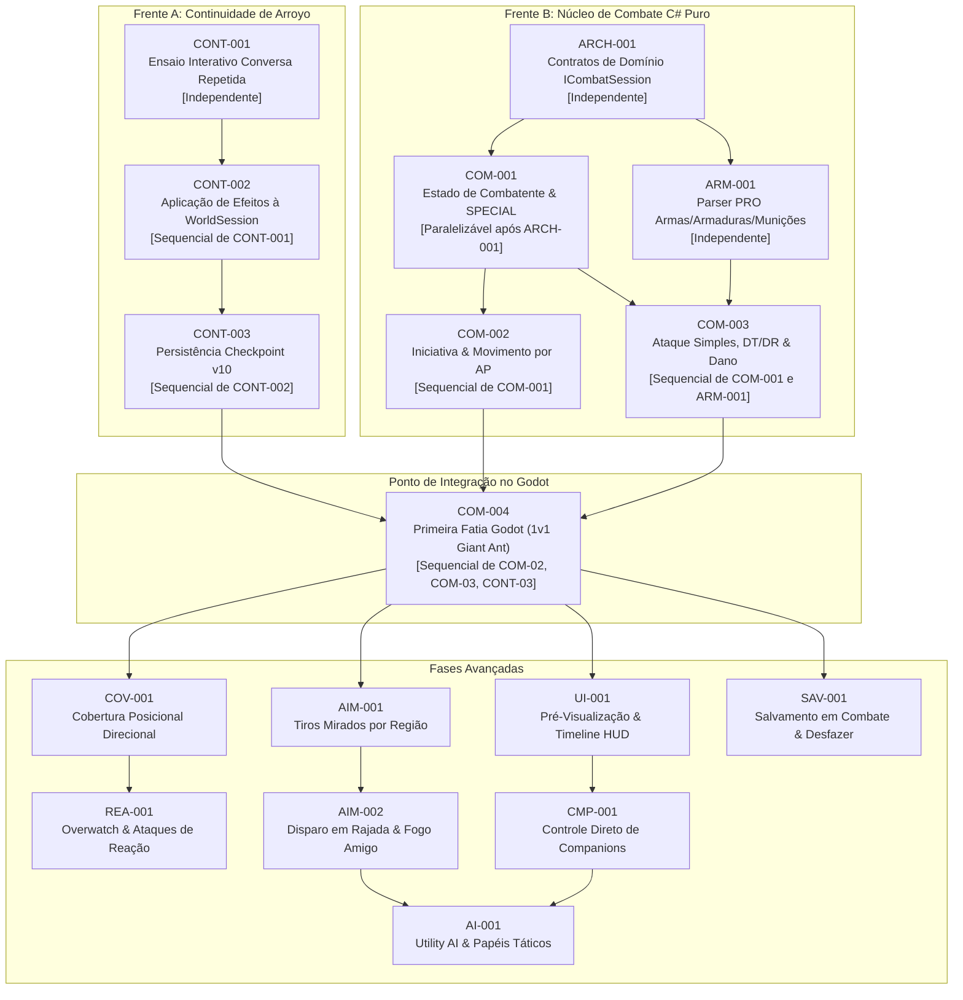

# FalloutRemake — Backlog Decomposto de Pacotes de Trabalho Paralelo

> **Status:** Catálogo Operacional de Tarefas e Contratos  
> **Data de Elaboração:** 28 de Outubro de 2026  
> **Autor da Análise:** Gemini Flash 3.8 (Agente Solo)  
> **Base de Código:** Commit `a66f31c` (`codex/arroyo-elder-entry-audit`)  
> **Documento Principal:** [gameplay-combat-roadmap.md](file:///c:/Dev/FalloutRemake/docs/roadmap/gameplay-combat-roadmap.md)  
> **Guia de Governança Paralela:** [parallel-agent-workflow.md](file:///c:/Dev/FalloutRemake/docs/development/parallel-agent-workflow.md)

---

## 1. Visão Geral e Modelo de Paralelismo

O backlog do **FalloutRemake** é decomposto em **Pacotes de Trabalho (Work Packages)** altamente delimitados e testáveis. A arquitetura desacoplada do projeto (onde a lógica de domínio reside em C# puro e a apresentação gráfica reside no Godot) permite que múltiplos agentes de IA (**Gemini Argon**, **Claude** e **Codex**) trabalhem simultaneamente em suas respectivas Git worktrees (`D:\Dev\FalloutRemakeCodex`, `C:\Dev\FalloutRemakeClaude`, `D:\Dev\FalloutRemakeIntegracao`) sem colisões de escrita.

### Classificação de Paralelismo das Tarefas:
- **Independente:** Pode iniciar imediatamente sem aguardar nenhuma outra tarefa.
- **Paralelizável após contrato:** Pode ser desenvolvida em paralelo assim que uma interface ou assinatura de contrato mínima for estabilizada.
- **Sequencial:** Depende estritamente do comportamento final de uma tarefa prévia aprovada.
- **Transversal:** Afeta múltiplos módulos simultaneamente e exige coordenação rigorosa na worktree de integração.

---

## 2. Grafo Global de Dependências e Clusters Paralelos

---

## 3. Catálogo Detalhado de Pacotes de Trabalho

### FRENTE A — CONTINUIDADE DAS FEATURES EXISTENTES

#### [CONT-001] Ensaio Interativo da Conversa Repetida da Anciã na UI
- **Objetivo:** Integrar à janela de consulta da Anciã em `TemplePreview` o ensaio navegável do diálogo repetido (`Node004`), auditado em `ArroyoElderRepeatAudit.cs`.
- **Requisitos Cobertos:** `NARR-001`, `UI-004`.
- **Resultado Esperado:** Jogador que concluiu o primeiro diálogo pode clicar na Anciã e navegar pelas opções 118, 119, 121, 122, 123 de `Node004`, alcançando `Node013` ou `Node999` com textos reais de `ahelder.msg`.
- **Classificação:** **Independente.** (Não depende de nenhuma tarefa de combate).
- **Arquivos Candidatos a Alteração:**
  - `src/Preview/ArroyoElderConsultationPreview.cs`
  - `src/Preview/ArroyoElderWindow.cs`
- **Novos Arquivos:** Nenhum.
- **Arquivos Compartilhados:** `src/Preview/TemplePreview.cs` (coordenação de signals).
- **Critérios de Aceitação:**
  1. A janela exibe mensagem 117 e suas opções de resposta.
  2. Opção de área 11 (mensagem 118) permanece indisponível conforme `metarule(17, 11) == 0`.
  3. Navegação encerra limpamente em `Node999`.
  4. Nenhuma mutação no mapa ativo de Arroyo ocorre neste passo.
- **Testes:** Novo método em `ArroyoElderConsultationChecks.cs` validando o fluxo repetido.
- **Complexidade:** Baixa (1–2 dias).

---

#### [CONT-002] Aplicação Controlada dos Efeitos de Diálogo à WorldSession
- **Objetivo:** Conectar transacionalmente a conclusão do diálogo da Anciã à máquina de estados viva `WorldSession`.
- **Requisitos Cobertos:** `NARR-002`, `SAV-002`.
- **Resultado Esperado:** Ao concluir o diálogo da Anciã com confirmação no HUD (`CommitElderDialogueRequested`), a `WorldSession` grava `GVAR_TALKED_TO_ELDER (531) = 1` e atualiza as variáveis locais do ator (reação e flags).
- **Classificação:** **Sequencial.** (Depende de `CONT-001`).
- **Arquivos Candidatos a Alteração:**
  - `src/Runtime/WorldSession.cs`
  - `src/Runtime/ArroyoElderStateProfile.cs`
  - `src/Preview/TemplePreview.cs`
- **Arquivos Compartilhados:** `WorldSession.cs` (método transacional dedicado).
- **Critérios de Aceitação:**
  1. O commit ocorre apenas uma vez por sessão.
  2. `GVAR_TALKED_TO_ELDER` muda de 0 para 1.
  3. Tentativa de commit com dados contraditórios ou sessão violada gera `InvalidDataException` atômica sem corromper o estado do mundo.
- **Testes:** Teste sintético em `tools/TempleInspector/ArroyoElderStateTests.cs`.
- **Complexidade:** Média (2 dias).

---

#### [CONT-003] Persistência do Diálogo da Anciã no Checkpoint (Schema v10)
- **Objetivo:** Evoluir o formato serializado `WorldCheckpoint` para a versão 10, armazenando o estado do diálogo da Anciã e garantindo migração retroativa de saves v1–v9.
- **Requisitos Cobertos:** `SAV-003`.
- **Resultado Esperado:** Checkpoint gravado retém `SavedElderState`; carregamento restaura o estado sem perder XP ou portas.
- **Classificação:** **Sequencial.** (Depende de `CONT-002`).
- **Arquivos Candidatos a Alteração:**
  - `src/Runtime/WorldCheckpoint.cs`
  - `tools/TempleInspector/CheckpointTests.cs`
- **Critérios de Aceitação:**
  1. Saves legados v1–v9 migram determinística e seguramente para v10.
  2. Arquivo excede 1 MB é recusado.
  3. `CheckpointTests` valida ida e volta (round-trip) perfeita em JSON.
- **Testes:** 10 novos casos em `CheckpointTests.cs`.
- **Complexidade:** Média (2 dias).

---

### FRENTE B — NÚCLEO DE COMBATE TÁTICO MODERNIZADO

#### [ARCH-001] Definição de Contratos e Interfaces de Combate (`ICombatSession`)
- **Objetivo:** Estabelecer a interface canônica e os tipos imutáveis de dados de combate desacoplados do Godot.
- **Requisitos Cobertos:** `ARCH-001`, `COM-001`.
- **Resultado Esperado:** Declaração de `ICombatSession`, `CombatActionProposal`, `CombatActionResult`, `CombatTurnState` em C# puro.
- **Classificação:** **Independente.** (Desbloqueia todo o desenvolvimento da Frente B).
- **Novos Arquivos:**
  - `src/Runtime/Combat/ICombatSession.cs`
  - `src/Runtime/Combat/CombatContracts.cs`
- **Critérios de Aceitação:**
  1. Interface 100% C# puro (.NET 8) sem referências ao namespace `Godot`.
  2. Totalmente compatível com compilação em `TempleInspector`.
- **Testes:** Compilação limpa do projeto.
- **Complexidade:** Baixa (1 dia).

---

#### [COM-001] Modelo de Dados do Combatente e Atributos SPECIAL
- **Objetivo:** Implementar `CombatantState` e a classe completa de estatísticas derivadas a partir de `CritterPrototypeData`.
- **Requisitos Cobertos:** `COM-001`, `COM-002`.
- **Resultado Esperado:** Cálculo determinístico de MaxHP, MaxAP, AC, Sequence, Melee Damage e Resistências para qualquer criatura PRO.
- **Classificação:** **Paralelizável após contrato.** (Depende de `ARCH-001`).
- **Novos Arquivos:**
  - `src/Runtime/Combat/CombatantState.cs`
  - `src/Runtime/Combat/DerivedCombatStats.cs`
  - `tools/TempleInspector/CombatantStatsTests.cs`
- **Critérios de Aceitação:**
  1. Formiga Gigante (PID 382) deriva 18 HP, 7 AP, AC 4, Sequence 50.
  2. Escorpião (PID 5) deriva 32 HP, 6 AP, AC 3, Sequence 150.
  3. Jogador neutro (SPECIAL 5 em tudo) deriva 30 HP, 7 AP, AC 5, Sequence 10.
- **Testes:** 15 novos testes unitários em `TempleInspector`.
- **Complexidade:** Média (2 dias).

---

#### [ARM-001] Decodificação de Campos de Combate de Armas, Armaduras e Munições
- **Objetivo:** Estender o parser `PrototypeCatalog.cs` e criar `WeaponPrototypeData`, `ArmorPrototypeData` e `AmmoPrototypeData`.
- **Requisitos Cobertos:** `ARM-001`, `ARM-002`.
- **Resultado Esperado:** Leitura exata de min/max dano, alcance, custo de AP, rajada, DT/DR e modificadores a partir de arquivos `.pro` binários.
- **Classificação:** **Independente.** (Atua em `src/Import/` sem interferir em runtime ou preview).
- **Novos Arquivos:**
  - `src/Import/WeaponPrototypeData.cs`
  - `src/Import/ArmorPrototypeData.cs`
  - `src/Import/AmmoPrototypeData.cs`
  - `tools/TempleInspector/ItemCombatPrototypeTests.cs`
- **Arquivos Candidatos a Alteração:** `src/Import/PrototypeCatalog.cs`
- **Critérios de Aceitação:**
  1. Lança (PID 7) decodifica dano 3–10, alcance 2, custo 4 AP.
  2. Pistola 10mm (PID 4) decodifica dano 5–12, alcance 25, custo 5 AP, capacidade 12.
- **Testes:** 20 testes em `ItemCombatPrototypeTests.cs`.
- **Complexidade:** Média (2–3 dias).

---

#### [COM-002] Ordem de Iniciativa e Movimentação por AP
- **Objetivo:** Implementar a máquina de turnos e o consumo de 1 AP por hexágono utilizando `HexNavigation`.
- **Requisitos Cobertos:** `COM-003`, `COM-004`.
- **Resultado Esperado:** Ordem de turnos baseada em Sequence; movimentação do combatente consome APs finitos e interrompe ao esgotar.
- **Classificação:** **Sequencial.** (Depende de `COM-001`).
- **Novos Arquivos:**
  - `src/Runtime/Combat/CombatInitiative.cs`
  - `src/Runtime/Combat/CombatMovement.cs`
  - `tools/TempleInspector/CombatTurnTests.cs`
- **Critérios de Aceitação:**
  1. Rodada ordena combatentes por Sequence decrescente.
  2. Movimentação deduz rigorosamente 1 AP por hex transitado.
  3. Movimento bloqueado se $\text{AP} < \text{Distância}$.
- **Testes:** 15 testes em `CombatTurnTests.cs`.
- **Complexidade:** Média (2 dias).

---

#### [COM-003] Resolução de Ataque Simples, DT/DR e Aplicação de Dano
- **Objetivo:** Implementar `CombatResolver` com as fórmulas clássicas de Chance de Acerto e dedução de DT/DR.
- **Requisitos Cobertos:** `COM-005`, `COM-006`.
- **Resultado Esperado:** Cálculo percentual de acerto, sorteio de dano bruto, absorção por armadura e redução de HP do alvo, com detecção de morte ao atingir 0 HP.
- **Classificação:** **Sequencial.** (Depende de `COM-001` e `ARM-001`).
- **Novos Arquivos:**
  - `src/Runtime/Combat/CombatResolver.cs`
  - `src/Runtime/Combat/DamageCalculator.cs`
  - `tools/TempleInspector/CombatDamageTests.cs`
- **Critérios de Aceitação:**
  1. Chance de acerto limitada estritamente entre 5% e 95%.
  2. Dano bruto deduz DT e reduz percentualmente por DR.
  3. Morte do alvo ao atingir 0 HP emite evento `CombatantDied`.
- **Testes:** 25 testes em `CombatDamageTests.cs`.
- **Complexidade:** Média (3 dias).

---

### PONTO DE CONVERGÊNCIA — PRIMEIRA FATIA VERTICAL NO GODOT

#### [COM-004] Primeira Fatia Vertical de Combate Integrada (1v1 Formiga Gigante)
- **Objetivo:** Integrar a máquina de combate em C# puro à cena de apresentação Godot (`TemplePreview`), concretizando o primeiro duelo jogável no Templo dos Testes.
- **Requisitos Cobertos:** `COM-007`, `UI-001`.
- **Resultado Esperado:** Jogador entra em combate na Sala 1 do Templo, troca turnos consumindo APs, mata a formiga gigante e recebe 25 XP, com encerramento limpo do modo de combate.
- **Classificação:** **Sequencial.** (Depende de `COM-002`, `COM-003` e `CONT-003`).
- **Arquivos Candidatos a Alteração:**
  - `src/Preview/TemplePreview.cs`
  - `src/Preview/PreviewHud.cs`
  - `src/Runtime/WorldSession.cs`
- **Novos Arquivos:**
  - `src/Preview/CombatViewAdapter.cs`
  - `src/Preview/CombatHudBar.cs`
- **Critérios de Aceitação:**
  1. Transição fluida de exploração para combate sem travar a câmera ou o HUD.
  2. Ataque do jogador reduz visualmente a barra de HP da formiga.
  3. Turno da formiga executa movimentação e mordida animada.
  4. Morte da formiga concede 25 XP únicos e libera o hex para caminhada.
- **Testes:** Validação in-engine headless (`tools/Validate-Temple.ps1`).
- **Complexidade:** Alta (4–5 dias).

---

### FASES AVANÇADAS — MODERNIZAÇÕES E SISTEMAS PARALELOS

| ID | Nome do Pacote de Trabalho | Pré-Requisitos | Arquivos Candidatos | Complexidade | Classificação |
| :--- | :--- | :--- | :--- | :---: | :--- |
| **COV-001** | Cobertura Posicional Direcional (Half/Full Cover) | `COM-004` | `src/Geometry/CombatCover.cs`, `SightOcclusion.cs` | Média | Paralelizável |
| **AIM-001** | Tiros Mirados por Região Corporal (Targeted) | `COM-004` | `src/Runtime/Combat/TargetedShots.cs`, `TargetedWheel.cs` | Média | Paralelizável |
| **AIM-002** | Disparo em Rajada, Dispersão e Fogo Amigo | `AIM-001` | `src/Runtime/Combat/BurstFireResolver.cs` | Alta | Sequencial de AIM-01 |
| **REA-001** | Overwatch e Ataques de Reação | `COV-001` | `src/Runtime/Combat/OverwatchSession.cs` | Alta | Sequencial de COV-01 |
| **UI-001** | Pré-Visualização Preditiva de Ações no HUD | `COM-004` | `src/Preview/ActionPreviewOverlay.cs`, `PreviewHud.cs`| Alta | Paralelizável |
| **CMP-001** | Controle Direto de Companions (Full Party Control)| `UI-001` | `src/Runtime/Combat/PartySession.cs`, `TemplePreview.cs`| Alta | Sequencial de UI-01 |
| **AI-001** | Utility AI Tática com Papéis e Anti-Fogo Amigo | `CMP-001`, `AIM-002`| `src/Runtime/AI/UtilityAiBrain.cs`, `TacticalRoles.cs` | Alta | Sequencial |
| **SAV-001** | Salvamento em Combate e Desfazer Movimento | `COM-004` | `WorldCheckpoint.cs`, `MovementUndoStack.cs` | Média | Paralelizável |
| **QOL-001** | Suporte Integral a Gamepad e Atalhos Rápidos | `UI-001` | `src/Preview/GamepadTacticalInput.cs` | Média | Paralelizável |
