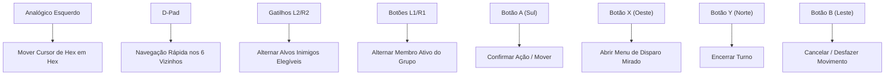

# FalloutRemake — Interface Tática, Controles e Qualidade de Vida (QoL)

> **Status:** Especificação de Produto e Apresentação Visual  
> **Data de Elaboração:** 28 de Outubro de 2026  
> **Autor da Análise:** Gemini Flash 3.8 (Agente Solo)  
> **Base de Código:** Commit `a66f31c`  
> **Referência Técnica:** Godot 4.7 .NET / C#, Wasteland 3, XCOM 2, Baldur's Gate 3  
> **Documento Principal:** [gameplay-combat-roadmap.md](file:///c:/Dev/FalloutRemake/docs/roadmap/gameplay-combat-roadmap.md)

---

## 1. Visão Geral da Interface Tática

A interface de combate do **FalloutRemake** foi projetada para combinar a estética retrô-futurista clássica do Pip-Boy e dos terminais RobCo com a clareza analítica dos melhores RPGs táticos modernos.

### Objetivos Principais:
1. **Eliminar Incertezas:** Toda consequência de uma ação (gasto de AP, chance de acerto, dano provável, contra-ataques) deve ser visível antes do clique final.
2. **Ritmo Ágil e Sem Esperas:** Eliminar o tempo morto em turnos de múltiplos inimigos distantes sem sacrificar a integridade da simulação.
3. **Ergonomia Universal:** Suporte integral e fluido para Teclado/Mouse e Gamepads contemporâneos.

---

## 2. Componentes da Interface de Combate

```text
┌──────────────────────────────────────────────────────────────────────────────────┐
│ [TIMELINE DE INICIATIVA: (1) Formiga A  → (2) O Escolhido  → (3) Sulik  → (4) ...] │
├──────────────────────────────────────────────────────────────────────────────────┤
│                                                                                  │
│                                (CENA DO MAPA 3D)                                 │
│                                                                                  │
│                        [Inimigo: Formiga]                                        │
│                              ▲                                                   │
│                       [Escudo Meia Cob]                                          │
│                              │                                                   │
│                      [Vetor de Disparo]                                          │
│                              │                                                   │
│                        [O Escolhido]                                             │
│                                                                                  │
├──────────────────────────────────────────────────────────────────────────────────┤
│ [HP: 30/30]   [AP: ● ● ● ● ○ ○ ○ (4/7)]   [Arma: Lança (4 AP)]   [Postura: Normal]│
│ [Ação Primária: Estocada]   [Mira: Cabeça (-40%)]   [Overwatch: Ativar] [Passar] │
└──────────────────────────────────────────────────────────────────────────────────┘
```

### 2.1. Timeline de Iniciativa (Sequence Bar)
- Posicionada na parte superior central da tela.
- Exibe os retratos dos combatentes na ordem estrita de `Sequence`.
- Destaque em amarelo pulsante para o combatente atualmente ativo.
- Ícones em miniatura sobre cada retrato indicam:
  - Barra de HP percentual.
  - Condições temporárias ativas (envenenamento, aleijamento, atordoamento).
  - Marcador de Overwatch ativo (ícone de olho ou mira engatilhada).
- Hover sobre qualquer retrato na timeline destaca a posição física daquele combatente no grid 3D.

### 2.2. Projeções no Grid Hexagonal (Overlays)
- **Área de Movimento Alcançável:** Hexágonos transitáveis destacados em azul translúcido suave.
- **Área de Movimento com Saldo para Ataque:** Hexágonos onde o jogador pode parar e ainda ter AP suficiente para atacar são destacados com contorno dourado.
- **Linha de Tiro (LOS Vector):** Traçado direto do atacante ao alvo com código de cores:
  - *Verde:* Linha limpa sem obstáculos.
  - *Amarelo:* Interceptada por meia cobertura (Half Cover).
  - *Laranja:* Interceptada por quina de cobertura total ou escuridão.
  - *Vermelho Tracejado:* Linha bloqueada por parede ou obstáculo intransponível.
- **Ícones de Cobertura:** Escudos flutuantes discretos sobre a borda do hexágono voltada para a ameaça:
  - *Meio Escudo Prateado:* Meia cobertura (-20% acerto do atacante).
  - *Escudo Cheio Dourado:* Cobertura total (-40% acerto ou quebra de visão).

### 2.3. Seletor de Mira por Região Corporal (Targeted Wheel)
- Ao selecionar um ataque mirado, abre-se uma roda tática ao redor do cursor:
  - Exibe a silhueta da criatura dividida em partes (Olhos, Cabeça, Tronco, Braços, Pernas, Virilha).
  - Cada segmento mostra a porcentagem calculada de acerto e o multiplicador de crítico.
  - Atolho rápido via teclas numéricas (1 a 6) ou direcional no Gamepad.

---

## 3. Ritmo, Animações e Fast-Forward

Um dos maiores problemas do Fallout 2 clássico eram os longos turnos em que dezenas de formigas ou aldeões se moviam lentamente pelo mapa.

### 3.1. Controle de Velocidade
- **Multiplicador Global de Animação:** Configuração nas preferências visuais para 1.0x, 1.5x, 2.0x ou 3.0x.
- **Avanço Rápido (Fast-Forward):** Segurar a tecla `Espaço` ou botão `B` no Gamepad durante o turno dos inimigos acelera as animações em 4.0x.
- **Omissão de Animação Fora da Visão (Off-Screen Skip):**
  - Inimigos localizados fora do campo de visão do jogador executam seu movimento e decisões de IA instantaneamente em C# puro, sem carregar malhas 3D ou reproduzir passos na engine.
  - **Garantia de Simulação:** O resultado da IA e das rolagens matemáticas permanece rigorosamente determinístico e idêntico, independentemente da velocidade gráfica.

---

## 4. Salvamento durante o Combate (In-Combat Saving)

O salvamento em combate é garantido pela extensão do formato `WorldCheckpoint` atômico.

### 4.1. Estado Capturado
Ao salvar no meio de um combate:
1. **Identificador da Sessão de Combate:** GUID único e estado do gatilho do mapa.
2. **Índice da Rodada e Turno:** Qual combatente está com o turno aberto e quantos APs restam.
3. **Estado Individual dos Combatentes:** Posições em hexes, HPs atuais, APs reservados, armas sacadas e condições ativas.
4. **Estado da Semente Pseudo-Aleatória (RNG State):**
   - O estado do gerador aleatório é serializado.
   - *Nota Técnica sobre Save Scumming:* Salvar a semente impede que o jogador recarregue o mesmo frame para tentar rolar um crítico diferente com a mesma ação, pois a próxima rolagem já estará pré-determinada pela sequência pseudo-aleatória.

---

## 5. Desfazer Movimento (Movement Undo)

Para evitar erros acidentais de clique no grid hexagonal sem violar as regras de integridade do combate:

### 5.1. Condições Estritas de Validade
O jogador pode desfazer uma caminhada (tecla `Z` ou `Back` no Gamepad) e recuperar seus APs **apenas se nenhuma das seguintes condições tiver ocorrido**:
1. Nenhum ataque ou uso de item foi iniciado.
2. Nenhum novo inimigo previamente oculto na névoa de guerra foi avistado.
3. Nenhuma armadilha de piso (Floor Trap) foi acionada.
4. Nenhum ataque de reação ou Overwatch inimigo foi disparado.

Se qualquer ação com impacto aleatório ou revelação de informação desconhecida tiver ocorrido, o botão de desfazer é desativado permanentemente naquele turno.

---

## 6. Interação com o Mundo e Acessibilidade

### 6.1. Destaque de Objetos Interagíveis (Highlight System)
- Pressionar ou segurar a tecla `Tab` destaca em contorno brilhante:
  - Contêineres, baús e armários (Amarelo).
  - Portas e interruptores (Ciano).
  - Itens caídos no chão e cadáveres saqueáveis (Verde).
  - Inimigos e armadilhas ativas (Vermelho).

### 6.2. Saque Rápido em Área (Area Looting)
- Ao abrir o inventário de um cadáver ou baú, uma aba secundária exibe todos os outros recipientes e corpos situados a até 2 hexes de distância, permitindo "Saquear Tudo" (`Take All`) de uma só vez, com checagem estrita de peso total (`CarryWeight`).

---

## 7. Suporte a Gamepad de Primeira Classe

A navegação tática por controle não é uma simples emulação de mouse:



---

## 8. Câmera Isométrica, Resoluções e Ultrawide

- **Câmera Ortográfica Isométrica Suave:**
  - Rotação livre em 4 ângulos cardeais de 90° para inspecionar quinas de paredes.
  - Zoom analógico suave com amortecimento inercial, mantendo a nitidez das texturas e fontes.
- **Suporte a Resoluções Modernas:**
  - Suporte nativo a 16:9 (1080p, 1440p, 4K), 16:10 (Steam Deck / Mac) e 21:9 / 32:9 Ultra-Wide.
  - Na proporção ultrawide, as bordas estendem o enquadramento do mapa tático sem esticar ou cortar elementos de HUD.
  - Interface vetorial com escalonamento DPI adaptável para telas portáteis de alta densidade.
